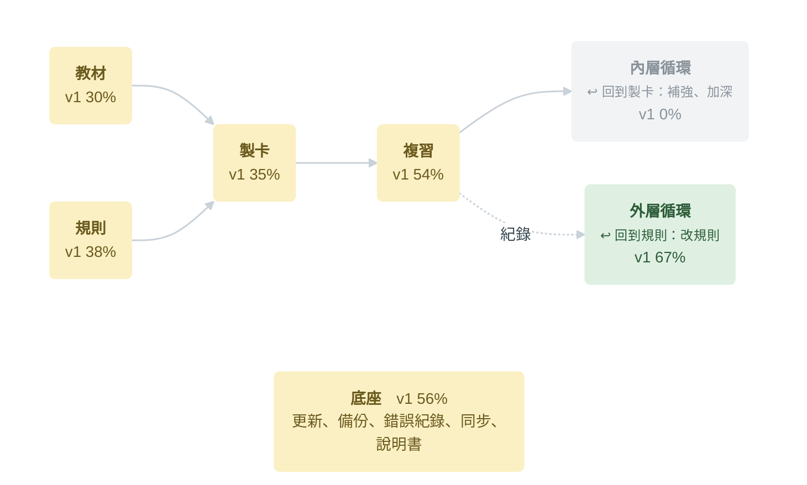

# Essence｜全專案功能地圖（草稿）

> [!note] 草稿，還沒定案
> 2026-11-06 依 `main` 的程式與文件判斷，沒有逐項實際操作。流程照 [architecture.md §8 整條鏈的分工](https://github.com/kuohappiness/Essence-Cards/blob/main/docs/architecture.md#8-整條鏈的分工-)，另加「底座」。
> 🟢 做完　🟡 做了一部分　⚪ 還沒開工（以上是 v1）　🔵 v1 之後
> 在 Obsidian 可以點標題旁的箭頭收合；在 GitHub 用右上角的目錄跳到某一段。

## 總覽

| 段 | 做什麼 | v1 進度 | 🟢 | 🟡 | ⚪ | 🔵 |
|---|---|---|:-:|:-:|:-:|:-:|
| [教材](#教材) | 把課本、講義變成 AI 和複習都讀得到的文字（Essence Capture） | `███░░░░░░░` 30% | 1 | 1 | 3 | 1 |
| [規則](#規則) | 告訴 AI 怎麼拆學習目標、怎麼出題（製卡規則） | `████░░░░░░` 38% | 0 | 6 | 2 | 2 |
| [製卡](#製卡) | 把教材變成卡組：手寫，或 AI 產生後家長審核 | `████░░░░░░` 35% | 4 | 1 | 8 | 2 |
| [複習](#複習) | 學生每天在 iPhone 上複習、自評，程式排下一次 | `█████░░░░░` 54% | 11 | 4 | 9 | 8 |
| [內層循環](#內層循環) | 看複習結果，補強不會的、加深已經會的 | `░░░░░░░░░░` 0% | 0 | 0 | 7 | 4 |
| [外層循環](#外層循環) | 用實際紀錄找出製卡規則哪裡不好，再改規則 | `███████░░░` 67% | 2 | 0 | 1 | 2 |
| [底座](#底座) | 讓上面每一段都能安全運作：更新、備份、錯誤、同步、說明書 | `██████░░░░` 56% | 4 | 2 | 3 | 5 |
| **全部** | | **`████░░░░░░` 42%** | **22** | **14** | **33** | **24** |

v1 共 69 項、v1 之後 24 項。進度用項目數算（🟢 算 1、🟡 算一半），不是工作量；還沒開工的大多在製卡、內層循環和教材，那幾塊的工作量比較大。

## 教材

把課本、講義變成 AI 和複習都讀得到的文字（Essence Capture）。v1 `███░░░░░░░` 30%　🟢 1　🟡 1　⚪ 3　🔵 1

### 轉錄（Essence Capture）　`█░░░░`

| | 功能 | 現況 |
|:-:|---|---|
| 🟡 | 推薦的 AI 服務與模型 | T4 實測選定模型（[ai-models.md](https://github.com/kuohappiness/Essence-Cards/blob/main/docs/ai-models.md)）；家長的預設選單還沒做 |
| ⚪ | PDF 與圖片轉錄成教材庫 | 圖表截圖、錨點、保留頁碼；repo 只有說明檔，雛形在 `experiments/t4/` |
| ⚪ | 轉錄稿和原頁比對 | AI 標出沒把握的地方 |

### 教材來源　`██░░░`

| | 功能 | 現況 |
|:-:|---|---|
| 🟢 | 自己寫的筆記當教材 | 手寫卡組連到筆記段落 |
| ⚪ | 教材不限課本、補充筆記另外放 | D-152；跟 AI 製卡模組做 |
| 🔵 | NotebookLM 對照與匯入 | 暫緩 |

## 規則

告訴 AI 怎麼拆學習目標、怎麼出題（製卡規則）。v1 `████░░░░░░` 38%　🟢 0　🟡 6　⚪ 2　🔵 2

### 通用規則　`██░░░`

| | 功能 | 現況 |
|:-:|---|---|
| 🟡 | 通用規則（R3 五步） | 暫選 R3，第三輪等新教材 |
| 🟡 | 不限學業的知識領域 | 規則寫好了，等 AI 製卡模組 |

### 科目預設　`██░░░`

| | 功能 | 現況 |
|:-:|---|---|
| 🟡 | 國中自然 | 規則已用過 |
| 🟡 | 英文 | v0.14 草稿，翰林八上 L4、L5 試過 |
| 🟡 | 國小社會 | v0.7，試用先停 |
| 🟡 | 國小國語 | v0.7，接著試 L8 |
| 🔵 | 各科的學習地圖規範 | 數學、歷史、地理、公民等；指定 v1 之後必做 |

### 家長調整與改版　`░░░░░`

| | 功能 | 現況 |
|:-:|---|---|
| ⚪ | 家長調整規則（第 ④ 層） | D-020 |
| ⚪ | 內建規則改版時的處理 | D-151：沒改過的跟著更新，自訂版提示家長 |
| 🔵 | 可抽換的製卡規則 | 一段時期換重點、匯入專家寫的方向；待討論 |

## 製卡

把教材變成卡組：手寫，或 AI 產生後家長審核。v1 `████░░░░░░` 35%　🟢 4　🟡 1　⚪ 8　🔵 2

### 手寫卡組　`████░`

| | 功能 | 現況 |
|:-:|---|---|
| 🟢 | 直接在 Obsidian 編輯卡組 |  |
| 🟢 | 自由安排卡組位置 |  |
| 🟢 | 學習目標 ID 自動配、重複 ID 先停家長選 | D-034、D-157 |
| 🟢 | 語法檢查：寫錯只跳過那個目標並提示 | 存檔時提示 |
| 🟡 | 編輯畫面標示結構 | 樣式標示在入口與目錄第四批 |
| ⚪ | Bases 卡組清單 |  |

### AI 接法　`░░░░░`

| | 功能 | 現況 |
|:-:|---|---|
| ⚪ | 訂閱接法 | 要先過 G1～G4 驗證（D-126） |
| ⚪ | 複製貼上 |  |
| ⚪ | API 直連 |  |
| ⚪ | 筆記與側欄修改 |  |
| ⚪ | 點選填空的家長勾選 | D-182、D-192 |

### 審核與快照　`░░░░░`

| | 功能 | 現況 |
|:-:|---|---|
| ⚪ | AI 卡片的審核：草稿 → 啟用 | 卡組的啟用／暫停已有 |
| ⚪ | AI 製卡快照 | D-042 |

### v1 之後

| | 功能 | 現況 |
|:-:|---|---|
| 🔵 | 完整卡片管理、候選卡勾選介面 |  |
| 🔵 | 多種呈現、備註提示、AI 反向題、填空漸進 |  |

## 複習

學生每天在 iPhone 上複習、自評，程式排下一次。v1 `█████░░░░░` 54%　🟢 11　🟡 4　⚪ 9　🔵 8

### 每天的份　`████░`

| | 功能 | 現況 |
|:-:|---|---|
| 🟢 | 今天要複習（入口一科一列） |  |
| 🟢 | 出卡順序 |  |
| 🟢 | 新卡 |  |
| 🟡 | 每日時間上限 | 排程有用；設定頁還不能調 |
| ⚪ | 濾網 | 設定頁的部分還沒做 |

### 作答與題型　`██░░░`

| | 功能 | 現況 |
|:-:|---|---|
| 🟢 | 翻面與四級自評 |  |
| 🟢 | 英文打字比對 | D-158 |
| 🟢 | 題目池輪替 |  |
| 🟢 | 題型接點與點選填空（相似字比較卡） | 2026-11-06 合併；iPhone 還沒測 |
| ⚪ | 接句卡的畫面 | D-185 |
| ⚪ | 全詩順序卡 | D-187 |
| ⚪ | 英文的新目標（打字、排序） | D-193 |
| ⚪ | 記憶錨點改成圖示 | D-184 |
| 🔵 | 拼句練習、造句 |  |
| 🔵 | 找錯題 | 改到 v1 之後 |
| 🔵 | 題庫、選擇題、考古題模擬考 |  |
| 🔵 | 國文卡的楷書 |  |
| 🔵 | 英文重點詞彙多一題新情境 | 暫緩 |

### 朗讀　`██░░░`

| | 功能 | 現況 |
|:-:|---|---|
| 🟢 | 英文朗讀 |  |
| ⚪ | 朗讀改成喇叭圖示 | D-188 |
| ⚪ | 中文朗讀 | 做法另開一串談 |
| 🔵 | 發音檢查、語音模型 |  |

### 排程　`████░`

| | 功能 | 現況 |
|:-:|---|---|
| 🟢 | FSRS 排程 |  |
| 🟡 | 目標保持率 | 排程有用；設定頁還不能調 |
| 🔵 | FSRS 參數個人化 |  |

### 範圍與目錄　`██░░░`

| | 功能 | 現況 |
|:-:|---|---|
| 🟢 | 考試範圍 | iPhone 還沒測 |
| 🟢 | 小考前的密集複習（練習） |  |
| 🟡 | 目錄與卡片管理 | 第一、二批合併；第三批（管理模式）還沒開 |
| 🟡 | 跳回出處 | 筆記可以跳；轉錄稿等 Capture |
| ⚪ | 小考標記 | 可以開工 |
| ⚪ | 考前抽測 |  |

### Essence Mindboard

| | 功能 | 現況 |
|:-:|---|---|
| 🔵 | 把知識架構畫成圖、挖空回想 | 第三個外掛，還沒開工 |

## 內層循環

看複習結果，補強不會的、加深已經會的。v1 `░░░░░░░░░░` 0%　🟢 0　🟡 0　⚪ 7　🔵 4

### 補強　`░░░░░`

| | 功能 | 現況 |
|:-:|---|---|
| ⚪ | 錯題補強：拍考卷 → 錯題本草稿 → 採用 | D-061、D-113 |
| ⚪ | 練今天採用的錯題補強 | D-159 |
| ⚪ | 常錯單字補記憶錨點 | D-103、D-108 |
| ⚪ | 某一題總是答錯時提醒拆開 | D-028 |
| 🔵 | 看錯題說明、考前弱點講義 |  |

### 加深　`░░░░░`

| | 功能 | 現況 |
|:-:|---|---|
| ⚪ | 循序漸進加深 | D-100、D-136 |
| ⚪ | 加深的主動提示 | D-194 已定案，跟 AI 製卡模組做 |
| 🔵 | 知識庫、依能力產生複習、精熟循環 |  |

### 給家長　`░░░░░`

| | 功能 | 現況 |
|:-:|---|---|
| ⚪ | 給家長的建議（入口提醒區） | D-103 |
| 🔵 | 學生回報問題的家長列表 | 記錄的部分 v1 已做 |

### 動機

| | 功能 | 現況 |
|:-:|---|---|
| 🔵 | 學習儀表板、記憶狀態地圖、晉升與獎賞 | 含學習地圖的視覺化 |

## 外層循環

用實際紀錄找出製卡規則哪裡不好，再改規則。v1 `███████░░░` 67%　🟢 2　🟡 0　⚪ 1　🔵 2

### 證據與改進　`███░░`

| | 功能 | 現況 |
|:-:|---|---|
| 🟢 | 複習紀錄（只往後追加） |  |
| 🟢 | 製卡規則的試用紀錄 | [trials.md](https://github.com/kuohappiness/Essence-Cards/blob/main/docs/card-rules/trials.md) |
| ⚪ | 比對 ID、計數、照固定條件重跑 | D-114 |
| 🔵 | 用家長的採用率優化製卡規則 | 靠 v1 的快照 |
| 🔵 | AI 評測集、多家庭規則回饋 | 暫緩 |

## 底座

讓上面每一段都能安全運作：更新、備份、錯誤、同步、說明書。v1 `██████░░░░` 56%　🟢 4　🟡 2　⚪ 3　🔵 5

### 更新與備份　`███░░`

| | 功能 | 現況 |
|:-:|---|---|
| 🟢 | 版本紀錄、讀取閘門、正式安裝 | D-149；0.1.0 |
| 🟢 | 外掛內備份 | D-150、D-162；0.2.0 |
| ⚪ | 還原畫面 | v1 結案前做 |
| 🔵 | 模型自動更新 |  |

### 錯誤與回報　`█████`

| | 功能 | 現況 |
|:-:|---|---|
| 🟢 | 正式版的錯誤紀錄 | D-155、D-173 |
| 🟢 | 學生在複習畫面回報問題 | D-160 |

### 檔案與同步　`██░░░`

| | 功能 | 現況 |
|:-:|---|---|
| 🟡 | iCloud 雲端佔位檔 | Windows 做完；iPhone 與三列技術債等觸發點 |
| 🟡 | 設定頁 | 依功能分區已有；保持率、每日上限、濾網還沒 |
| ⚪ | 系統資料夾的防呆 |  |
| 🔵 | 不用 iCloud 的同步（Dropbox 最小驗證） |  |
| 🔵 | 獨立 App、網頁版 |  |
| 🔵 | 三個外掛共用設定 |  |
| 🔵 | 自訂配色、英文版介面 |  |

### 說明　`░░░░░`

| | 功能 | 現況 |
|:-:|---|---|
| ⚪ | 使用說明書（HTML） | 段落已累積在 D-048 補充 |

## 資料從哪裡來

功能清單來自 [product.md §5](https://github.com/kuohappiness/Essence-Cards/blob/main/docs/product.md#5-範圍-第-7-步)、[backlog 的 v1 任務](https://github.com/kuohappiness/Essence-Cards/blob/main/docs/backlog.md#v1-需要做的任務)與[第二階段清單](https://github.com/kuohappiness/Essence-Cards/blob/main/docs/backlog.md#第二階段想做的事)，狀態對照 [roadmap](https://github.com/kuohappiness/Essence-Cards/blob/main/docs/roadmap.md#現在在哪裡)。功能的說明不在這裡重寫，只放名稱、狀態和一句現況。
