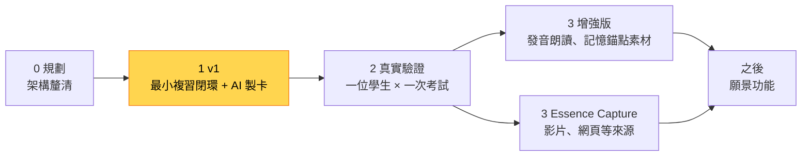

# Essence Cards｜開發現況與路線圖

更新：2026-10-21

## 現在在哪裡

| 項目 | 現況 |
|---|---|
| 階段 | **1. v1**：v1 開發前要做的事全部完成，2026-10-20 開始寫程式 |
| 產品程式碼 | 程式結構已定（[D-110](decisions.md#d-110-v1-外掛的程式結構)）；W1 骨架＋W2 卡組模組、W3 複習紀錄與 FSRS 重播（含自動檢查，[D-117](decisions.md#d-117-技術債預防機械檢查全自動ai-審查只在關鍵點)）已合併進 main（183 個測試）；下一步把 W4 今天的佇列（[任務說明](../tasks/w4.md)）交給 Codex |
| 已驗證 | Windows 與 iPhone：最小原型（2026-10-07）；複習畫面原型與實機驗證全部過門檻（2026-10-19，[D-109](decisions.md#d-109-複習畫面原型的實測結論)） |
| 下一個里程碑 | 打通「手寫卡組 → iPhone 複習 → 自評 → 排程」（W1～W6，[D-111](decisions.md#d-111-v1-的開發順序capture-延後)）；Capture 延到這之後 |

開工時只讀這一節，其他文件看任務需要再讀（[D-099](decisions.md#d-099-文件精簡)）。要找某個決定，先看[決策紀錄的索引](decisions.md#索引)；最近做完的事見[已完成](#已完成)。

### 下一次對話從這裡開始

1. **v1 第一批**（[D-111](decisions.md#d-111-v1-的開發順序capture-延後)）：W1 骨架、W2 卡組模組（[任務說明](../tasks/w1-w2.md)、[審查與修正](<../Claude Codex Discussion/2026-10-20-technical-debt-review.md>)）與 W3 複習紀錄與 FSRS 重播（[任務說明](../tasks/w3.md)，排程用 FSRS-6，[D-112](decisions.md#d-112-排程用-fsrs-6)）已合併。下一步把 W4 今天的佇列的[任務說明](../tasks/w4.md)（[D-120](decisions.md#d-120-今天的佇列的細節)）交給 Codex；W3 的 iPhone 效能（D-110 要不要加快取）在 W5 接上外掛後用 `npm run bench` 的資料量測。程式結構照 [D-110](decisions.md#d-110-v1-外掛的程式結構)；試作場已停用。之後各模組寫規格時，照 [D-115](decisions.md#d-115-回頭查要用的證據先收好) 把要多存的證據寫進出題語法，打字卡與自動朗讀照 [D-116](decisions.md#d-116-打字卡的沒印象與自動朗讀)。開始任務前，先核對 [backlog 的技術債](backlog.md#技術債)（W1～W2 審查留下的 4 件事已搬過去，[D-119](decisions.md#d-119-程式品質的-skill-整併成通用的-code-quality)）。
2. 製卡規則：學習目標的數量由內容決定（[D-101](decisions.md#d-101-學習目標的數量由內容決定)）2026-10-19 試過，沒有變瑣碎，規則不改（[試用紀錄](card-rules/trials.md)）。之後有真實的影片筆記時再試一次，順便看一般知識的數量（這次約加倍，同一份筆記 20～31 個）。下一輪試用時一併試「共同成功判準」（[backlog](backlog.md#其他待決)）。也一併看 AI 品質初篩留下的兩點：2-2 每份仍約 5 題洩漏（多是二選一與互補配對），以及把相鄰能力的一題放錯池（D-118）。
3. **AI 品質初篩** ✅ 2026-10-20 結案：兩次盲評後照兩個問題改了規則（通用 v0.13、自然 v0.5，[D-118](decisions.md#d-118-ai-品質初篩後的製卡規則修改)），T4 小規模驗證：例題的觀念都有出題、按例子拆開變少，洩漏沒變、偶爾把相鄰能力的一題放錯池（[試用紀錄](card-rules/trials.md)）。這兩點併進第 2 項的下一輪試用再看，不擋 v1。

另外的專題與研究：

- **學習目標架構**（[討論稿](<../Claude Codex Discussion/2026-10-21-learning-objective-architecture.md>)）：2026-10-21 使用者要求把「製卡規則的寫法」（[前一份](<../Claude Codex Discussion/2026-10-20-card-rule-writing.md>)，暫停）歸零重想，同意新方向：用真實考題當尺、先用最強的模型找天花板、比較單次與流水線（架構 → 出題 → 另一家審查），詳細規則改給審查者用。結論使用者 2026-10-21 確認（強模型用 xhigh）；單元是 2-2，保留單元 2-1、2-3，尺是第一次段考。考題已凍結、生成完成 2-1 與 2-2；第一輪只評這兩節（使用者決定，2-3 不補）。盲評包已做好（12 份卡組、10 份架構），評分說明見 [`arch/評分說明.md`](../experiments/t4/arch/評分說明.md)。下一步：Claude 與 Codex 各開新對話盲評（卡組 → 架構 → 缺口，各自鎖定），之後 Claude 揭曉對照、寫報告。
- **AI 規劃**（[紀錄](archive/discussions/2026-10-11-ai-planning.md)），待決題目見 [backlog](backlog.md#ai-規劃2026-10-11-起的專題討論)。
- **API 挑選**（[紀錄](archive/discussions/2026-10-11-api-selection.md)）：T4 已選定轉錄用 GPT-6 Sol、製卡用 GPT-5.6 Terra（D-085）。使用者之後再測：錯題照片（照 [D-113](decisions.md#d-113-錯題整頁拍題號選填) 整頁拍，等使用者提供 2～3 張字跡潦草的真實考卷）、Mistral 的其他模型；增強版再談語音模型與模型自動更新。
- **English Kitten Academy 研究**（[報告](research/english-kitten-academy.md)、[討論稿](<../Claude Codex Discussion/2026-10-20-english-kitten-academy.md>)）：2026-10-21 結案。拼句練習、文法選擇題、造句題的可接受答案留 v2（[backlog](backlog.md#點子收集箱)）。使用者要 v1 做「片語放進句子裡打字」：答錯時的三步流程已定（[D-121](decisions.md#d-121-打字卡答錯時的三步流程)，W6 照做）；寫法、依字數畫線、好幾個正確答案用 ` | ` 分開已定（[D-122](decisions.md#d-122-片語放進句子裡打字)，英文規則 v0.8）；解析器拆開 ` | ` 寫進 W6 的任務說明（[技術債](backlog.md#技術債)）。

## 路線圖

v1 的內容已確認（[D-039](decisions.md#d-039-v1-範圍)）。💡 v1 之後的增強版與 Essence Capture，先後順序依真實驗證的結果決定。

| 階段 | 內容 | 完成條件 |
|---|---|---|
| 0 規劃 ✅ 2026-10-20 | 架構釐清七步 ✅ 2026-10-10，結果寫在 [product](product.md) 與 [architecture](architecture.md)；接著做[v1 開發前要做的事](#v1-開發前要做的事) | product.md 與 architecture.md 沒有 💬 項目；v1 範圍確定 |
| 1 v1 | [產品定義 §5](product.md#5-範圍-第-7-步)的 v1 範圍，包括 AI 製卡（[D-039](decisions.md#d-039-v1-範圍)） | 能在 iPhone 完成一次段考範圍的每日複習；附上完整的 HTML 使用說明書，並說清楚學習目標 ID 與題目指紋（[D-048](decisions.md#d-048-使用說明書)） |
| 2 真實驗證 | 一位學生、一次考試 | 依[成功標準](product.md#2-成功標準-第-1-步)記錄結果，決定下一步優先順序 |
| 3 增強版 | 發音朗讀、記憶錨點的素材等；要加強什麼到時候再討論（[backlog](backlog.md#增強版待討論)） | 待定 |
| 3 Essence Capture | 另一個 repo；PDF 與圖片的轉錄已提前進 v1（D-076），這裡是影片、網頁等其他來源 | 待定 |
| 之後 | [產品定義 §5「之後」](product.md#之後方向保留暫不展開)的四組：動機與管理、應用與回饋、內容深化、生態與維運；細節見 [backlog](backlog.md) | — |

## v1 開發前要做的事

| 事項 | 內容 |
|---|---|
| 出題語法定稿 | ✅ 2026-10-16（[D-092](decisions.md#d-092-出題語法定稿正式規範)）：正式規範見[出題語法與資料格式](syntax.md)，製卡規則的輸出格式已同步；整合時補上的三個提案同一天確認 |
| 成功標準的量測方式 | ✅ 2026-10-12（[D-075](decisions.md#d-075-成功標準的量測方式)）：v1 只做積欠提醒與考前抽測，其他在第 2 階段由 AI 讀紀錄計算 |
| 複習與檢核細節 | ✅ 2026-10-13：自評段數、佇列組成、中斷與恢復等十三題都已定案（[backlog](backlog.md#複習與檢核細節v1-範圍確定後展開)） |
| 實機驗證（舊 T-008） | ✅ 2026-10-19（[試作場](../experiments/README.md) T3）：離線連續複習 15 分鐘、離線重開、恢復連線後同步都通過，三年份紀錄 iPhone 讀 0.24 秒；兩端離線改同一篇筆記會遺失一邊、裝置代碼要存本機，記入 [backlog](backlog.md#其他待決)。單一檔案救回在電腦用 Git 做，寫 v1 時處理 |
| 複習畫面樣式與入口畫面 | ✅ 2026-10-17（[試作場](../experiments/README.md) T1、T5）：複習畫面用安靜樣式、自評按鈕不顯示間隔（[D-070](decisions.md#d-070-複習畫面採用安靜樣式)）；入口一科一列（[D-095](decisions.md#d-095-入口畫面)）；顯示答案用文字按鈕、空格是底線、詳解和答案分開（[D-096](decisions.md#d-096-顯示答案與複習畫面的細節)）；目錄依學期分組、單元數字是卡片總數並用顏色表示狀態、點開有當日卡與全部卡（[D-097](decisions.md#d-097-目錄畫面)）；考試範圍只用在大考、改成考試期間（[D-098](decisions.md#d-098-考試範圍只用在大考日期改成考試期間)）。樣式稿：[入口與顯示答案](../experiments/mockups/entry-and-reveal.html)。英文自評按鈕 2026-10-17 確認（D-096）。設定頁 ✅ 2026-10-19：複習、學期、給家長三區，每日時間上限預設 30 分鐘（[D-104](decisions.md#d-104-設定頁)，依試作場 T8 的模擬），樣式照 Obsidian 內建；總覽 ✅ 2026-10-19 改成入口在電腦版、有建議時才出現的「給家長」一區（[D-103](decisions.md#d-103-總覽改成入口的給家長一區)）。「給家長」一區已補進樣式稿第 16 版；考前抽測 ✅ 2026-10-19 放在入口科目列的第一列，考前 3 天出現（[D-107](decisions.md#d-107-考前抽測放在入口科目列的第一列)）。考試範圍檔的寫法已跟著 D-098 改好（[出題語法 §4](syntax.md#4-考試範圍)） |
| 複習畫面原型 | 在[試作場](../experiments/README.md)做（T2，[D-065](decisions.md#d-065-試作場)），照 T5 選定的複習畫面（D-096）；✅ 2026-10-19 [試作外掛](../experiments/plugin/README.md)在 Windows 與 iPhone 測完：維持 React，全螢幕蓋住 Obsidian 並攔截觸控，往左滑一次一張（[D-109](decisions.md#d-109-複習畫面原型的實測結論)） |
| 開始寫程式時：建立 Capture repo | ✅ 2026-10-20 照 [D-076](decisions.md#d-076-capture-是知識入口教材轉錄成教材庫) 的補充（2026-10-14）建好骨架：[Essence-Capture](https://github.com/kuohappiness/Essence-Capture) 與本 repo 並排、AGENTS.md 指向本 repo、通用的 Claude 記憶已複製、進度只寫在本 repo。Capture 的程式延到 Cards 的複習閉環完成後（[D-111](decisions.md#d-111-v1-的開發順序capture-延後)）；Capture 完成前 AGENTS.md 要改成獨立的一份（[backlog](backlog.md#其他待決)） |
| API 模型實測 | ✅ 2026-10-14（[試作場](../experiments/README.md) T4）：轉錄用 GPT-6 Sol、製卡用 GPT-5.6 Terra（[D-085](decisions.md#d-085-首選-openai-gpt-56-terra)）。使用者之後再測：錯題照片、Mistral 的其他模型（見上面「API 挑選」） |

## 已完成

只留最近 10 條；加新的一條時，把最舊的搬到[已完成（封存）](archive/roadmap-completed.md)的最上面（[D-099](decisions.md#d-099-文件精簡)）。

| 日期 | 工作 |
|---|---|
| 2026-10-21 | W3 複習紀錄與 FSRS 重播合併：第 0 步裝好 `npm run check`（型別、ESLint 模組邊界、knip、secretlint、skill 副本、測試）、pre-commit hook 與 CI；紀錄的讀寫與合併、FSRS-6 重播與到期日，驗算值全對。Codex 寫、新 Codex session 審查找到 6 項（寫入重試、排序、hook 檔名、動態 import、status 對象、效能門檻），Claude 核對後補規格、Codex 修正；效能改由 `npm run bench` 量（中位數約 450 ms／500 ms）；D-115 改寫成紀錄檔只追加不修改；CI 第一次跑時 `npm ci` 因 Windows 產生的 lock 缺 Linux 才用的 `@emnapi` 套件而失敗，改成明列為開發相依後通過 |
| 2026-10-21 | 片語放進句子裡打字：英文規則 v0.8（中文整句＋英文挖空、打出變化形；有會變的部分再出 1～2 題換主詞或時態；「只有一個答案」四條反例）。Terra 試用 14 份：多解 5 → 0～2 題，題幹都不洩漏原形，學習目標數不變；`parseDeck()` 都是 qa、zh-en、沒有 problems，` \| ` 不會拆開要交給 Codex（[試用紀錄](card-rules/trials.md)）；使用者照建議定案：寫法照 v0.8、依字數畫線、好幾個正確答案都接受，D-089 第 13 條與 syntax.md §2-3 一起改（[D-122](decisions.md#d-122-片語放進句子裡打字)） |
| 2026-10-21 | 打字卡答錯時的三步流程（使用者提出）：先給原形再試一次、第一步不標拼錯字母，還是不會就看著答案照打一次；自評只看第一次（[D-121](decisions.md#d-121-打字卡答錯時的三步流程)） |
| 2026-10-21 | English Kitten Academy 研究的 Claude 評估：片語放進句子裡打字列入 v1（使用者）；拼句當提示、文法選擇題、造句題的可接受答案列入 v2 討論（使用者同意），`take`／`for` 案例併入下一輪「共同成功判準」試用；Codex 同日已回覆，拼句的定位與提示後評分待 Claude 確認 |
| 2026-10-21 | W4 今天的佇列的任務說明：用今天以前的紀錄排出今天的份（五道、照時間上限切）、英文兩個方向的門檻與同一天只出一個、剛答錯的再出與提早出、題目池輪流、入口一科一列的進度，附 T1～T15 驗算；六個待決問題照建議定案：秒數用自己的作答間隔中位數、答對才算完成、新卡照筆記順序、學業以外合成一列、濾網寫分類或重要性、打字卡記 `typed`（D-120） |
| 2026-10-20 | English Kitten Academy 研究報告完成：分析拼句、文法、首次作答、題庫維護與同步；原題庫檢查通過，隔離測試重現同步佇列遺失作答；與既有 D-ID 對照後提出借鑑與不採用的界線，[交接稿](<../Claude Codex Discussion/2026-10-20-english-kitten-academy.md>)待 Claude 評估，未新增產品決定 |
| 2026-10-20 | 程式品質的 skill 整併（Claude 與 Codex 討論後使用者確認）：Matt Pocock 的 5 個 skill 合成通用的 `code-quality`，專案設定在 `docs/agents/quality.md`；高風險改動由新開的 Codex session 審查、Claude 核對；技術債移到 backlog 一節，每件寫觸發點與完成條件；`tools/check-skill-mirror.ts` 檢查 Claude 與 Codex 兩份 skill 一致，W3 第 0 步接進 `npm run check`（D-119） |
| 2026-10-20 | W1 骨架＋W2 卡組模組合併：Codex 寫、Codex 審查找到 7 項、Claude 核對另找到 3 項；合併前修好補 ID 不冪等（問答題的螢光筆留在名稱）、程式碼圍欄與標題跟著清單容器結束、文件層級縮排 4 欄不是清單、修改佇列不分大小寫；所有卡組範例自動跑補 ID 往返測試（156 份）；syntax.md §2-3 名稱規則釐清 |
| 2026-10-20 | AI 品質初篩結案、製卡規則修改：例題背後的觀念一定要出一題，備註寫出觀念出在哪個目標；同一個原理的不同例子放同一池；洩漏多三種判法（互補配對、答案在名詞裡算，池主題題不算），也寫進初篩任務說明；反例都取自其他單元。T4 驗證 4 份：2-2 的兩個例題觀念都有出題，熱的傳播目標 14～16 → 10～11、重複變少，洩漏沒變（通用 v0.13、自然 v0.5，D-118） |
| 2026-10-20 | 技術債預防：`npm run check`（型別、測試、ESLint 模組邊界、knip、secretlint）在 pre-commit 與 CI 自動跑，Codex 在 W3 第 0 步裝好；AI 審查只在大改動合併前，抓到能程式檢查的問題當場加規則；retro 與 security-review 每個里程碑一次（D-117） |

