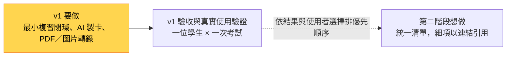

# Essence Cards｜開發現況與路線圖

更新：2026-10-27

## 現在在哪裡

v1 開發中（2026-10-20 開始寫程式）。開工只讀這一節；還沒開工的 v1 工作看 [backlog 的 v1 任務](backlog.md#v1-需要做的任務)，要找決定看[決策索引](decisions.md#索引)（[D-141](decisions.md#d-141-文件架構入口只放狀態同一類資訊只維護一份)）。

| 工作 | 狀態 | 下一步 | 等誰 | 入口 |
|---|---|---|---|---|
| W6 複習畫面 | 分支 `claude/w6`：Codex L2 的 F1～F3、F5～F7 已修，再審請求已寫好 | 再審請求交給新的 Codex；五題交給 Fable，回覆後 Opus 實作 F4 | 使用者轉交 | [任務說明](../tasks/w6.md)、[問題清單](../tasks/w6-l2-questions.md) |
| 卡組讀不到就跳過那一篇 | 實作完成待審：分支 `claude/state-load` | 審查請求交給新的 Codex 做 L2；通過後合併進 `main`，再併進 `claude/w6` 做 iPhone 測試 | 使用者轉交 | [任務說明](../tasks/state-load.md) |
| 國小社會預設 | v0.1 第一次試用完 | 決定地名配特色要不要出卡與四點修改，改成 v0.2，再用 Sol 對照 2-1 | 使用者 | [預設](card-rules/elementary-social.md) |
| 更新與相容 | 討論中 | 一次一題，先問每台裝置要不要記版本 | 使用者 | [規畫](plans/updates.md) |
| 外掛架構逐環節檢視 | 環節 1、7 已談定（7 見 [D-142](decisions.md#d-142-範圍與目錄模組的六項選擇)）；環節 8 雙方一致 | 使用者決定電腦專用的主機接點（改 D-053）；環節 4、5、6、9、2、3 等 `state-load` 與 W6 合併後再談 | 使用者 | [討論稿](<../Claude Codex Discussion/2026-10-26-plugin-architecture.md>) |
| 文件架構整理 | 執行中 | 照任務說明 | 本機 session | [任務說明](../tasks/docs-architecture.md) |
| 未來規畫統整的審閱 | Codex 2026-10-23 交接，未審 | Claude 審閱，或使用者決定結掉 | 使用者 | [討論稿](<../Claude Codex Discussion/2026-10-23-future-plans-consolidation.md>) |
| 學習目標架構第三輪 | 暫選 R3 | 兩三個新單元與段考到齊再跑 | 新教材 | [D-132](decisions.md#d-132-學習目標架構暫選-r3第三輪在新教材比三組) |
| 製卡規則下一輪試用 | 等真實影片筆記 | 看目標數量、共同成功判準、洩漏與放錯池 | 新教材 | [試用紀錄](card-rules/trials.md) |
| 英文一字多義 | 規則已改（D-125） | 有多義字的真實教材時試用 | 新教材 | [D-125](decisions.md#d-125-英文規則依製卡流程重排與一字多義的學習目標) |

下一個里程碑：W1～W6 打通「手寫卡組 → iPhone 複習 → 自評 → 排程」（D-111）；W5、W6 都合併後，提醒使用者做 code-quality 的里程碑回顧與安全檢查，A1～A3 請 Codex 核對。

## 路線圖

只分 **v1 需要做的任務** 與 **第二階段想做的事**（[D-130](decisions.md#d-130-任務分成-v1-與第二階段)）。目前規格照 D-039、D-111 開發；第二階段不再細分「增強版」「v2 之後」等階段，也未排定功能先後。

| 工作 | 範圍與入口 | 完成或開工條件 |
|---|---|---|
| v1 需要做的任務 | [產品定義 §5](product.md#5-範圍-第-7-步)、[任務入口](backlog.md#v1-需要做的任務)。W4～W6 後接 AI 製卡與 Capture，照 D-111；目前進度見上方「現在在哪裡」 | 能在 iPhone 完成段考範圍的每日複習；交付完整 HTML 使用說明書（D-048），說明學習目標 ID 與題目指紋；依[成功標準](product.md#2-成功標準-第-1-步)和 D-075 做一位學生、一次考試的真實驗證。v1 完工前 Claude 仍先問使用者：[產品路線](plans/learning-growth.md)要不要納入部分內容；[學習地圖的視覺化](plans/motivation.md#使用者提議把學習地圖做成有質感的視覺化)要不要做（使用者 2026-10-26 要求在 v1 正式結案前提醒） |
| 第二階段想做的事 | [唯一清單](backlog.md#第二階段想做的事)，細項放 [docs/plans/](plans/README.md)，包括動機、題庫、內容深化、體驗、生態及獨立 App | 依驗證結果及使用者選擇排定要做的項目，再完成各自規格與驗收；列入不代表全部已採用或同版交付 |

## 未來準備開發：獨立 App

已列入第二階段清單（D-129），尚未實作；[開工準備與未決選擇](plans/standalone-app.md)集中在同一主題文件，架構邊界見[架構文件](architecture.md#未來獨立-app規劃中)。

## 已完成

只留最近 10 列，一列一句約 80 字加連結；加新的一列時，把最舊的搬到[已完成（封存）](archive/roadmap-completed.md)的最上面，相對路徑改成以 `docs/archive/` 為基準（[D-099](decisions.md#d-099-文件精簡)、[D-141](decisions.md#d-141-文件架構入口只放狀態同一類資訊只維護一份)）。

| 日期 | 工作 |
|---|---|
