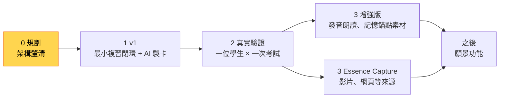

# Essence Cards｜開發現況與路線圖

更新：2026-10-19

## 現在在哪裡

| 項目 | 現況 |
|---|---|
| 階段 | **0. 規劃**：架構釐清七步已完成，接著做 v1 開發前要做的事 |
| 產品程式碼 | 尚未開始 |
| 已驗證 | Obsidian 外掛最小原型可在 Windows／iPhone 執行（2026-10-07） |
| 下一個里程碑 | 完成[v1 開發前要做的事](#v1-開發前要做的事)，開始寫程式 |

開工時只讀這一節，其他文件看任務需要再讀（[D-099](decisions.md#d-099-文件精簡)）。要找某個決定，先看[決策紀錄的索引](decisions.md#索引)；最近做完的事見[已完成](#已完成)。

### 下一次對話從這裡開始

1. [v1 開發前要做的事](#v1-開發前要做的事)：T5 已全部談定（考前抽測見 [D-107](decisions.md#d-107-考前抽測放在入口科目列的第一列)），接著做複習畫面原型（T2）、實機驗證。開始寫 Capture 時，T4 的轉錄提示照 [syntax.md §1](syntax.md#1-轉錄稿) 調整（圖檔名、子圖、表格 ID 前的空行、例題的寫法）。
2. 製卡規則：學習目標的數量由內容決定（[D-101](decisions.md#d-101-學習目標的數量由內容決定)）2026-10-19 試過，沒有變瑣碎，規則不改（[試用紀錄](card-rules/trials.md)）。之後有真實的影片筆記時再試一次，順便看一般知識的數量（這次約加倍，同一份筆記 20～31 個）。

另外兩條專題討論：

- **AI 規劃**（[紀錄](archive/discussions/2026-10-11-ai-planning.md)），待決題目見 [backlog](backlog.md#ai-規劃2026-10-11-起的專題討論)。
- **API 挑選**（[紀錄](archive/discussions/2026-10-11-api-selection.md)）：T4 已選定轉錄用 GPT-6 Sol、製卡用 GPT-5.6 Terra（D-085）。使用者之後再測：錯題照片、Mistral 的其他模型；增強版再談語音模型與模型自動更新。

## 路線圖

v1 的內容已確認（[D-039](decisions.md#d-039-v1-範圍)）。💡 v1 之後的增強版與 Essence Capture，先後順序依真實驗證的結果決定。

| 階段 | 內容 | 完成條件 |
|---|---|---|
| 0 規劃 | 架構釐清七步 ✅ 2026-10-10，結果寫在 [product](product.md) 與 [architecture](architecture.md)；接著做[v1 開發前要做的事](#v1-開發前要做的事) | product.md 與 architecture.md 沒有 💬 項目；v1 範圍確定 |
| 1 v1 | [產品定義 §5](product.md#5-範圍-第-7-步)的 v1 範圍，包括 AI 製卡（[D-039](decisions.md#d-039-v1-範圍)） | 能在 iPhone 完成一次段考範圍的每日複習；附上完整的 HTML 使用說明書，並說清楚學習目標 ID 與題目指紋（[D-048](decisions.md#d-048-使用說明書)） |
| 2 真實驗證 | 一位學生、一次考試 | 依[成功標準](product.md#2-成功標準-第-1-步)記錄結果，決定下一步優先順序 |
| 3 增強版 | 發音朗讀、記憶錨點的素材等；要加強什麼到時候再討論（[backlog](backlog.md#增強版待討論)） | 待定 |
| 3 Essence Capture | 另一個 repo；PDF 與圖片的轉錄已提前進 v1（D-076），這裡是影片、網頁等其他來源 | 待定 |
| 之後 | [產品定義 §5「之後」](product.md#之後方向保留暫不展開)的四組：動機與管理、應用與回饋、內容深化、生態與維運；細節見 [backlog](backlog.md) | — |

## v1 開發前要做的事

| 事項 | 內容 |
|---|---|
| 出題語法定稿 | ✅ 2026-10-16（[D-092](decisions.md#d-092-出題語法定稿正式規範)）：正式規範見[出題語法與資料格式](syntax.md)，製卡規則的輸出格式已同步；整合時補上的三個提案同一天確認 |
| 成功標準的量測方式 | ✅ 2026-10-12（[D-075](decisions.md#d-075-成功標準的量測方式)）：v1 只做積欠提醒與考前抽測，其他在第 2 階段由 AI 讀紀錄計算 |
| 複習與檢核細節 | ✅ 2026-10-13：自評段數、佇列組成、中斷與恢復等十三題都已定案（[backlog](backlog.md#複習與檢核細節v1-範圍確定後展開)） |
| 實機驗證（舊 T-008） | 在[試作場](../experiments/README.md)做（T3），和複習畫面原型的 iPhone 測試集中成一次（[D-065](decisions.md#d-065-試作場)）。另加：在 iPhone 上連續複習 15 分鐘，每次作答立刻寫入紀錄，檢查畫面順不順、iCloud 同步正不正常（[D-074](decisions.md#d-074-中斷與恢復)） |
| 複習畫面樣式與入口畫面 | ✅ 2026-10-17（[試作場](../experiments/README.md) T1、T5）：複習畫面用安靜樣式、自評按鈕不顯示間隔（[D-070](decisions.md#d-070-複習畫面採用安靜樣式)）；入口一科一列（[D-095](decisions.md#d-095-入口畫面)）；顯示答案用文字按鈕、空格是底線、詳解和答案分開（[D-096](decisions.md#d-096-顯示答案與複習畫面的細節)）；目錄依學期分組、單元數字是卡片總數並用顏色表示狀態、點開有當日卡與全部卡（[D-097](decisions.md#d-097-目錄畫面)）；考試範圍只用在大考、改成考試期間（[D-098](decisions.md#d-098-考試範圍只用在大考日期改成考試期間)）。樣式稿：[入口與顯示答案](../experiments/mockups/entry-and-reveal.html)。英文自評按鈕 2026-10-17 確認（D-096）。設定頁 ✅ 2026-10-19：複習、學期、給家長三區，每日時間上限預設 30 分鐘（[D-104](decisions.md#d-104-設定頁)，依試作場 T8 的模擬），樣式照 Obsidian 內建；總覽 ✅ 2026-10-19 改成入口在電腦版、有建議時才出現的「給家長」一區（[D-103](decisions.md#d-103-總覽改成入口的給家長一區)）。「給家長」一區已補進樣式稿第 16 版；考前抽測 ✅ 2026-10-19 放在入口科目列的第一列，考前 3 天出現（[D-107](decisions.md#d-107-考前抽測放在入口科目列的第一列)）。考試範圍檔的寫法已跟著 D-098 改好（[出題語法 §4](syntax.md#4-考試範圍)） |
| 複習畫面原型 | 在[試作場](../experiments/README.md)做（T2，[D-065](decisions.md#d-065-試作場)），照 T5 選定的入口、複習畫面與目錄（D-095～D-098） |
| 開始寫程式時：建立 Capture repo | 照 [D-076](decisions.md#d-076-capture-是知識入口教材轉錄成教材庫) 的補充（2026-10-14）設定：兩個資料夾並排、Capture 的 AGENTS.md 指向本 repo、複製通用的 Claude 記憶、進度只寫在本 repo 的路線圖。**AI 開始寫程式或建立 Capture repo 時，要主動提醒使用者照這份清單設定**，使用者不會記得要自己提 |
| API 模型實測 | ✅ 2026-10-14（[試作場](../experiments/README.md) T4）：轉錄用 GPT-6 Sol、製卡用 GPT-5.6 Terra（[D-085](decisions.md#d-085-首選-openai-gpt-56-terra)）。使用者之後再測：錯題照片、Mistral 的其他模型（見上面「API 挑選」） |

## 已完成

只留最近 10 條；加新的一條時，把最舊的搬到[已完成（封存）](archive/roadmap-completed.md)的最上面（[D-099](decisions.md#d-099-文件精簡)）。

| 日期 | 工作 |
|---|---|
| 2026-10-19 | 入口瘦身（D-106）：試作場說明與製卡規則說明只留現況、使用方式與待驗證事項；T1、T5 的過程移到 [`mockups/`](../experiments/mockups/README.md)，T6、T8 移到 [`tts-probe/`](../experiments/tts-probe/README.md)、[`load-sim/`](../experiments/load-sim/README.md)，模型選型與 Jev 移到 [`t4/`](../experiments/t4/README.md)，製卡規則的試用合併成[試用紀錄](card-rules/trials.md)。兩份入口約 20,000 → 9,500 字元 |
| 2026-10-19 | 考前抽測放在入口科目列的第一列：考前 3 天出現，電腦和 iPhone 都有，不算進今日複習，做完可看結果與弱單元（[D-107](decisions.md#d-107-考前抽測放在入口科目列的第一列)）；樣式稿第 16 版補上考前抽測與「給家長」一區。說明書加一章圖文的複習流程（D-048） |
| 2026-10-19 | Claude 與 Codex 的協作流程：archive 分成已取代的 v0 規劃與過程紀錄；TASK 寫必讀範圍與基準 commit；小改動審查不開子代理但檢查不減；討論稿常設在 `Claude Codex Discussion/`；路線圖移出已完成的架構釐清七步、補正兩列過期現況（D-106） |
| 2026-10-19 | 回測要用的紀錄先收好：回測程式放第 2 階段；複習紀錄多記設定、狀態、濾網的變更，考試範圍提前結束不刪檔，全部在背景；T3 加三年份紀錄的效能實測（D-105） |
| 2026-10-19 | 設定頁：複習（每日時間上限 5～90 分鐘、預設 30，全部科目加起來；考試倒數）、學期（每年 2/1、8/1 自動換）、給家長（目標保持率、AI 製卡只在電腦版）；不上鎖；成功標準改成平均每天 ≤ 15 分鐘（D-104） |
| 2026-10-19 | 試作場 T8 每日時間上限模擬，國中三年：上限只是天花板，平均做的時間不變；英文加自然 15 分鐘夠用，五科加作答慢時 15 分鐘撐不住（新卡平均等 10 天、段考範圍 37% 還沒開始），30 分鐘都撐得住 |
| 2026-10-19 | 總覽改成入口的「給家長」一區：只在電腦版、有建議時出現，每項附一顆按鈕（積欠寫張數、某科很久沒做、常錯單字補錨點、待審核卡組），狀態列提示；不做獨立的總覽畫面（D-103） |
| 2026-10-19 | 學生也能調每日時間上限：設定頁學生和家長都能調，總覽顯示分鐘數；份量照樣用時間管、不限張數（D-102） |
| 2026-10-19 | 製卡規則試用：學習目標的數量由內容決定（D-101），T4 程式、Terra，一般知識 16 份、自然 2-2 3 份。瑣碎的目標一般知識 3/297、2-2 0/35，沒有變瑣碎；一般知識的目標數約加倍（睡眠 11.6 → 23.5），2-2 多 3 成（8.8 → 11.7）；為壓數量合併 0/19，候選卡片合理。規則不改 |
| 2026-10-19 | 學習目標的數量由內容決定：拿掉每頁、每份筆記與加深時的固定目標數，份量交給第 ① 層與每日時間上限；課本列出的學習目標轉錄成 `> [!學習目標]`，製卡時當對照表 → 通用 v0.11、一般 v0.3（D-101） |

