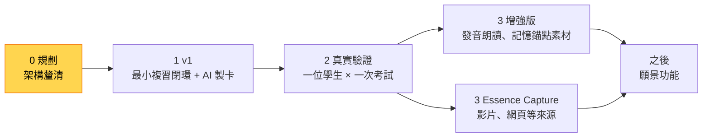

# Essence Cards｜開發現況與路線圖

更新：2026-10-11

## 現在在哪裡

| 項目 | 現況 |
|---|---|
| 階段 | **0. 規劃**：架構釐清七步已完成，接著做 v1 開發前要做的事 |
| 產品程式碼 | 尚未開始 |
| 已驗證 | Obsidian 外掛最小原型可在 Windows／iPhone 執行（2026-10-07） |
| 下一個里程碑 | 完成[v1 開發前要做的事](#v1-開發前要做的事)，開始寫程式 |

## 路線圖

v1 的內容已確認（[D-039](decisions.md#d-039-v1-範圍)）。💡 v1 之後的增強版與 Essence Capture，先後順序依真實驗證的結果決定。

| 階段 | 內容 | 完成條件 |
|---|---|---|
| 0 規劃 | 架構釐清七步（見下方） | product.md 與 architecture.md 沒有 💬 項目；v1 範圍確定 |
| 1 v1 | [產品定義 §5](product.md#5-範圍-第-7-步)的 v1 範圍，包括 AI 製卡（[D-039](decisions.md#d-039-v1-範圍)） | 能在 iPhone 完成一次段考範圍的每日複習；附上完整的 HTML 使用說明書，並說清楚學習目標 ID 與題目指紋（[D-048](decisions.md#d-048-使用說明書)） |
| 2 真實驗證 | 一位學生、一次考試 | 依[成功標準](product.md#2-成功標準-第-1-步)記錄結果，決定下一步優先順序 |
| 3 增強版 | 發音朗讀、記憶錨點的素材等；要加強什麼到時候再討論（[backlog](backlog.md#增強版待討論)） | 待定 |
| 3 Essence Capture | 另一個 repo；PDF 與圖片的轉錄已提前進 v1（D-076），這裡是影片、網頁等其他來源 | 待定 |
| 之後 | [產品定義 §5「之後」](product.md#之後方向保留暫不展開)的四組：動機與管理、應用與回饋、內容深化、生態與維運；細節見 [backlog](backlog.md) | — |

## 目前任務：架構釐清七步

一次只談一題，談定後寫進對應文件，並在[決策紀錄](decisions.md)新增條目。

| 步驟 | 主題 | 寫進 | 狀態 |
|---|---|---|---|
| 1 | 成功標準：誰、哪一科、哪次考試、量什麼 | [product §2](product.md#2-成功標準-第-1-步) | ✅ 2026-10-10 |
| 2 | 核心使用情境：主要與次要 | [product §3](product.md#3-使用者與情境-第-2-步) | ✅ 2026-10-10（螺旋式情境的歸類待定） |
| 3 | 產品原則：精簡成 5～7 條 | [product §4](product.md#4-產品原則-第-3-步) | ✅ 2026-10-10 |
| 4 | 概念模型：v1 實際需要哪些實體 | [architecture §2](architecture.md#2-概念模型-第-4-步) | ✅ 2026-10-10 |
| 5 | 模組邊界：Cards 與 Capture 的分工和約定 | [architecture §3](architecture.md#3-模組邊界-第-5-步) | ✅ 2026-10-10（v1 材料來源在第 6 步確認） |
| 6 | 資料存放：教材目錄、學習目標 ID、複習紀錄格式 | [architecture §5](architecture.md#5-資料存放-第-6-步) | ✅ 2026-10-10（出題語法在寫程式前定稿） |
| 7 | v1 範圍：要做、之後、不做 | [product §5](product.md#5-範圍-第-7-步) | ✅ 2026-10-10 |

並行任務：**製卡規則試用** ✅ 第一輪通過（2026-10-10）。規則已更新為 v0.1；之後每做一個新科目或新題型，再用同樣方式試用（[試用方式與紀錄](card-rules/README.md)）。下一個要試用的是「一般知識」預設 v0：用一部影片的筆記試一次（D-038）；以及循序漸進加深：同一節先出第 ① 層，再假設部分目標已熟練、出第 ② 層，和一次出完比較（D-077）。

## v1 開發前要做的事

| 事項 | 內容 |
|---|---|
| 出題語法定稿 | 使用者提供舊 Obsidian 閃卡外掛的完整 repo；助理檢視語法，以及其他可以參考的地方，再和使用者做最後確認（[D-030](decisions.md#d-030-出題語法規範)）。定稿後同步更新製卡規則的輸出格式。2026-10-10 已取得 repo 並完成[分析報告](research/old-flashcard-plugin.md)；排程已定為 FSRS（D-043），語法方向已確認，剩學習目標的表示方式等細節待確認 |
| 成功標準的量測方式 | ✅ 2026-10-12（[D-075](decisions.md#d-075-成功標準的量測方式)）：v1 只做積欠提醒與考前抽測，其他在第 2 階段由 AI 讀紀錄計算 |
| 複習與檢核細節 | 自評段數、佇列組成、中斷與恢復等十二個問題（[backlog](backlog.md#複習與檢核細節v1-範圍確定後展開)） |
| 實機驗證（舊 T-008） | 在[試作場](../experiments/README.md)做（T3），和複習畫面原型的 iPhone 測試集中成一次（[D-065](decisions.md#d-065-試作場)）。另加：在 iPhone 上連續複習 15 分鐘，每次作答立刻寫入紀錄，檢查畫面順不順、iCloud 同步正不正常（[D-074](decisions.md#d-074-中斷與恢復)） |
| 複習畫面樣式與入口畫面 | 複習畫面已選定安靜樣式，自評按鈕不顯示間隔（[D-070](decisions.md#d-070-複習畫面採用安靜樣式)，[試作場](../experiments/README.md) T1）。還剩：自評按鈕的英文版本（提案見 D-070，「差一點」不用 Hard）；外掛的入口畫面（開始複習、目錄、總覽怎麼安排），開始複習的按鈕一定要明顯（[D-057](decisions.md#d-057-目錄畫面與卡片管理)）；入口只顯示今天的份、分科按鈕、濾網提示，考試範圍最多三步（[D-071](decisions.md#d-071-每天的複習怎麼排)）；目錄的管理模式（[D-073](decisions.md#d-073-目錄擴充成卡片管理)）；顯示答案的方式（試作場 T5：文字按鈕、眼睛圖示、霧化真答案、霧化同長度假文字）。**AI 開始做試作場的工作時，要主動提醒使用者 T5 還沒做**，使用者不會記得要自己提 |
| 複習畫面原型 | 在[試作場](../experiments/README.md)做（T2，[D-065](decisions.md#d-065-試作場)） |
| 開始寫程式時：建立 Capture repo | 照 [D-076](decisions.md#d-076-capture-是知識入口教材轉錄成教材庫) 的補充（2026-10-14）設定：兩個資料夾並排、Capture 的 AGENTS.md 指向本 repo、複製通用的 Claude 記憶、進度只寫在本 repo 的路線圖。**AI 開始寫程式或建立 Capture repo 時，要主動提醒使用者照這份清單設定**，使用者不會記得要自己提 |
| API 模型實測 | 在[試作場](../experiments/README.md)做（T4）：同一份教材比較 Gemini 3.8 Flash、Gemini 3.5 Flash-Lite 與 OpenRouter 的一個免費模型，確認 [AI 模型推薦](ai-models.md)（[D-072](decisions.md#d-072-ai-服務的推薦與設定方式)）。使用者只要申請金鑰、提供一節自然課本與幾題錯題照片 |

## 下一次對話從這裡開始

已完成：舊外掛分析的待討論題（D-049～D-054、D-057、D-058；[討論紀錄](archive/discussions/2026-10-10-old-plugin-followups.md)）、複習與檢核細節的十二題（D-062、D-066、D-068、D-069、D-071、D-073、D-074；[討論紀錄](archive/discussions/2026-10-11-review-details.md)）、成功標準的量測方式（D-075；[討論紀錄](archive/discussions/2026-10-12-success-metrics.md)）。

接下來：

1. **出題語法定稿**：把 D-045、D-046、D-049、D-050，以及卡片的狀態、來源、備註（D-063）、卡組分類（D-064）、中→英要打字的標示（D-066）、粗體重點（D-068）、同一個字的兩個方向（D-069）寫成正式規範；也包括錯題補強在卡組裡的標示與錯題本的格式（D-061）、記憶錨點放在卡片背面的寫法（D-067）、錯題本記下考試分數與班平均（D-075）。通用與英文製卡規則的輸出格式目前還是舊的 LT／Q／A 寫法，一併改成定稿的語法。學習目標 ID 寫成 Obsidian 原生區塊 ID（§7-4）：使用者已在 AI 規劃討論同意用它連結學習目標（D-048 附註），定稿時一併確認。也要定轉錄稿的頁碼標記（課本印的頁碼，只放在轉錄稿）與段落、圖表錨點，卡片的出處連到錨點（D-076）

另一條專題討論：**AI 規劃**（[紀錄](archive/discussions/2026-10-11-ai-planning.md)），待決題目見 [backlog](backlog.md#ai-規劃2026-10-11-起的專題討論)。

另一條專題討論：**API 挑選**（[紀錄](archive/discussions/2026-10-11-api-selection.md)）：T4 已選定轉錄用 GPT-6 Sol、製卡用 GPT-5.6 Terra（D-085）。使用者之後再測：錯題照片、Mistral 的其他模型；增強版再談語音模型與模型自動更新。

## 已完成

| 日期 | 工作 |
|---|---|
| 2026-10-14 | [Ágora 研究](research/agora.md)：教材和 AI 的知識不一致時照教材出題（D-086）；錯因加「先備知識不足」（D-087）；考古題模擬考、自訂目標、選擇題都併入題庫系統，放在 v2 討論 |
| 2026-10-14 | 試作場 T4 兩輪實測：轉錄與製卡首選 OpenAI GPT-5.6 Terra，Gemini 3.8 Flash 改成完全免費的入門；只用轉錄稿製卡可行（D-085） |
| 2026-10-15 | 出題語法定稿第 1～5 題：卡組結構與學習目標的資料（D-079）、轉錄稿的錨點與出處（D-080）、卡組屬性與檔名（D-081）、英文卡組與系統語音朗讀（D-082，試作場 T6） |
| 2026-10-13 | 出題語法定稿途中的三個題目：循序漸進加深採「熟了才產生下一層」（D-077）；目標保持率可以自訂、預設 80%，範圍填了考試日期後考前自動用 90%，每一科可以有自己的考試日期（D-078）；Mindmap 也可以當考題，要先挖空回想（D-056 補充） |
| 2026-10-13 | 比較舊專案最新的複習介面與安靜樣式；回看上一張與滑動手勢（D-084）；顯示答案的方式列入試作場 T5（眼睛圖示、霧化、字數提示） |
| 2026-10-13 | 三個外掛的定位：Capture 是知識入口、Cards 是複習工具、Mindmap 把知識架構視覺化；Capture 提前進 v1，把 PDF 與圖片忠實轉錄成教材庫，PDF 不放進 vault，跳回出處改成打開轉錄稿的錨點（D-076） |
| 2026-10-12 | AI 模型推薦：兩個外掛推薦同一個帳號，首選 Google AI Studio、備案 OpenRouter；設定頁提供預設選單；新增 [AI 模型推薦](ai-models.md) 文件；產品原則第 5 條擴大到家長，前提是不影響學習品質（D-072、D-023 補充） |
| 2026-10-12 | 複習畫面選定安靜樣式，自評按鈕不顯示間隔；樣式稿加上拼字卡、重點標示與「新」標籤，路徑加上年級（D-070） |
| 2026-10-11 | 設立試作場：repo 的 `experiments/` 與 iCloud 測試 vault「Essence Cards Test」；AI 能測的由 AI 測（D-065） |
| 2026-10-11 | 自評四級：沒印象／差一點／記住了／太簡單；答錯的卡依時間再出；記憶配色改為灰、橙、綠、藍（D-062） |
| 2026-10-12 | 成功標準的量測方式：v1 只做積欠提醒與考前抽測；其他在第 2 階段由 AI 讀紀錄計算；量測結果不會自動修改製卡規則（D-075） |
| 2026-10-12 | 中斷與恢復：每次作答立刻寫入、還沒按的卡回來再出、進度不歸零、復原上一張（D-074）。複習與檢核細節全部定案 |
| 2026-10-12 | 每天的複習怎麼排：只顯示今天的份、重要的與快忘的先出、分科按鈕、濾網、考試範圍最多三步、清晨 4 點換日（D-071）；目錄擴充成卡片管理，可以勾選後批次修改（D-073） |
| 2026-10-12 | 新卡：一整課同一天開始、第一次答不出來不算忘記；先英→中再中→英；同一個字兩個方向同一天只出一個（D-069） |
| 2026-10-11 | 理解題的答案標出粗體重點、自評照重點算；翻面不是指標，看答案也是複習，每翻一張就算完成一次（D-068） |
| 2026-10-11 | 作答方式：預設在腦中回答；拼字併入中→英，學生打字、程式比對；讓 AI 判斷答案先取消（D-066） |
| 2026-10-11 | 不另外做標籤系統：篩選區把分類、狀態、來源、學習狀況、類型、重要性、備註做成可以點的標籤；備註用頓號分隔（D-063 附註） |
| 2026-10-11 | 開始 AI 規劃專題討論：釐清和 NotebookLM 的分工；NotebookLM 對照實驗排入 v1 開發前要做的事；模型免費或開源優先（D-055）；保留和未來心智圖外掛對接的彈性（D-056）；本機開源模型列為保留擴充，主要用來產生語音複習材料；API 直連只做一種介面、模型不包進外掛（D-059）；記憶狀態配色一致（D-060）；錯題補強的流程（D-061）；卡片的狀態、來源、學習狀況與備註（D-063）；製卡規則加入錯題處理；卡組分類改用屬性，Cards 不用 Obsidian 標籤（D-064）；AI 品質用採用率與漏掉率衡量（D-042 補充）；說明書教申請免費 API 金鑰（D-048 補充）；英文記憶錨點需要時才補（D-067）、AI 產生反方向題放到之後；NotebookLM 對照實驗暫緩，模型比較改由 API 規劃實測 |
| 2026-10-11 | 目錄畫面（學生與家長共用）、快速開始、總覽；不做卡片庫但保留擴充性；保留 Bases。複習畫面先做幾種樣式讓使用者選，自訂配色與問題回報放增強版（D-057、D-058）。舊外掛分析的待討論題全部完成 |
| 2026-10-11 | 舊外掛的卡片與進度都不匯入（D-054） |
| 2026-10-11 | 開發流程：沿用三段式與 Retrospective，改用 CI、一鍵安裝，新增分層檢查；不沿用舊的 Instruction、SKILL（D-053） |
| 2026-10-11 | 複習畫面用 React 加 Motion，樣式用純 CSS 與自己的設計規範；寫程式前做複習畫面原型（D-051、D-052） |
| 2026-10-11 | 不提供反向、雙向語法，每個方向各寫一行；英文製卡規則 v0.3（D-050） |
| 2026-10-10 | 一行多個填空一次全挖，撤回「輪流挖一個」的提案（D-049） |
| 2026-10-10 | 編輯畫面標示卡組結構（D-047）；完成前要做 HTML 使用說明書，說清楚 ID 與指紋（D-048） |
| 2026-10-10 | 學習目標用清單縮排、題目用內容指紋識別（D-045、D-046）；在雲端 Obsidian 實測舊外掛（報告附錄二） |
| 2026-10-10 | 排程採用 FSRS、介面體驗是重點方向（D-043、D-044）；實測舊外掛：69 個測試通過，重現 5 個問題；報告第二版依「最高標準」重新設計 14 個項目 |
| 2026-10-10 | 分析使用者的舊外掛 AI-Enriched Flashcards：可沿用的做法、發現的問題、建議討論的調整（[報告](research/old-flashcard-plugin.md)） |
| 2026-10-10 | AI 製卡快照：原始輸出存到 `紀錄/AI 輸出/`，家長照常刪改即可比對；審核以刪除方便為優先（D-042） |
| 2026-10-10 | 卡組用 YAML 屬性與 Obsidian 標籤分類，範圍可以選標籤；`Essence Cards/` 裡系統資料夾以外的筆記都是卡組（D-041） |
| 2026-10-10 | 卡組位置改為在 `Essence Cards/` 裡自由安排，年級學期、科目、單元記在卡組筆記裡（D-040） |
| 2026-10-10 | 架構釐清第 7 步：v1 範圍確定，包括 AI 製卡（複製貼上與 API 直連）、在卡組筆記裡審核、不限學業的知識領域；發音朗讀移到增強版；Capture 不提前（D-036～D-039）；新增「一般知識」製卡規則 v0 |
| 2026-10-10 | 架構釐清第 6 步：教材目錄從卡組自動組成、學習目標 ID 用隨機短碼、複習紀錄每台裝置每月一個檔；v1 材料可以是筆記或 PDF；影片不標時間點；出題語法在寫程式前參考舊外掛定稿（D-031～D-035） |
| 2026-10-10 | 架構釐清第 5 步：Capture 是通用知識保存工具，交接約定精簡為四項；需要出題語法規範（D-029、D-030） |
| 2026-10-10 | 架構釐清第 4 步：v1 五種資料、三者分開存放、儲存／範圍／排程分開、跨課題目規則、題目池（D-025～D-028）；製卡規則 v0.2 |
| 2026-10-10 | 架構釐清第 3 步：產品原則精簡為七條；前端介面由 Claude 設計，儀表板列為之後（[D-023](decisions.md#d-023-產品原則)、[D-024](decisions.md#d-024-前端介面設計)） |
| 2026-10-10 | 製卡規則第一輪試用通過：自然有附課本明顯較好；新增題目漸進（[D-021](decisions.md#d-021-教材是製卡依據)、[D-022](decisions.md#d-022-題目漸進)） |
| 2026-10-10 | 製卡規則四層設計（[D-020](decisions.md#d-020-製卡規則分層)）；起草通用、英文、自然三份規則 v0 與試用說明 |
| 2026-10-10 | 架構釐清第 2 步：家長製卡審核、學生複習；英文必備例句與發音；自然材料為課本 PDF 與錯題（[D-019](decisions.md#d-019-使用角色與材料)） |
| 2026-10-10 | 架構釐清第 1 步：成功標準、目標使用者、英文與國二上自然兩個驗證情境（[D-017](decisions.md#d-017-目標使用者)、[D-018](decisions.md#d-018-成功標準與驗證情境)） |
| 2026-10-10 | 北極星寫入文件；文件重整為五份核心文件，v0 規劃與看板封存（[D-014](decisions.md#d-014-文件重整)） |
| 2026-10-09 | 學習目標架構討論：三層模型、複習債務、漸進結構（[紀錄](archive/discussions/2026-10-09-learning-target-architecture-dialogue.md)） |
| 2026-10-07 | 可丟棄原型通過 Windows／iPhone 最小實機驗證 |
| 2026-10-06～07 | v0 規劃：平台、模組、AI 原則、參考軟體研究（見 [archive](archive/README.md)） |
