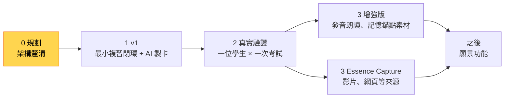

# Essence Cards｜開發現況與路線圖

更新：2026-10-17

## 現在在哪裡

| 項目 | 現況 |
|---|---|
| 階段 | **0. 規劃**：架構釐清七步已完成，接著做 v1 開發前要做的事 |
| 產品程式碼 | 尚未開始 |
| 已驗證 | Obsidian 外掛最小原型可在 Windows／iPhone 執行（2026-10-07） |
| 下一個里程碑 | 完成[v1 開發前要做的事](#v1-開發前要做的事)，開始寫程式 |

開工時只讀這一節，其他文件看任務需要再讀（[D-099](decisions.md#d-099-文件精簡)）。要找某個決定，先看[決策紀錄的索引](decisions.md#索引)；最近做完的事見[已完成](#已完成)。

### 下一次對話從這裡開始

1. **製卡規則試用**：循序漸進加深已試用（2026-10-17，T4 第七～九輪，[試用紀錄](card-rules/README.md)），通用 v0.9 加了 F 節。💬 待使用者決定：F 節照試用版確認嗎？加深要不要放進 v1（💡 助理建議放：只多一個「加深這一節」的入口，沿用 AI 製卡流程；新目標要先放進引言框審核，見 [backlog](backlog.md#出題語法定稿留下的待確認)）？一般知識 v0.1 還沒試：等使用者提供一部影片的筆記、一句學習目的和學習者程度（放進測試 vault）。試用時用 `experiments/t4/check-syntax.mjs` 檢查格式。
2. 其餘 [v1 開發前要做的事](#v1-開發前要做的事)：複習畫面原型（T2）、實機驗證；T5 還剩的設定頁與總覽也在那一列。開始寫 Capture 時，T4 的轉錄提示照 [syntax.md §1](syntax.md#1-轉錄稿) 調整（圖檔名、子圖、表格 ID 前的空行、例題的寫法）。

另外兩條專題討論：

- **AI 規劃**（[紀錄](archive/discussions/2026-10-11-ai-planning.md)），待決題目見 [backlog](backlog.md#ai-規劃2026-10-11-起的專題討論)。
- **API 挑選**（[紀錄](archive/discussions/2026-10-11-api-selection.md)）：T4 已選定轉錄用 GPT-6 Sol、製卡用 GPT-5.6 Terra（D-085）。使用者之後再測：錯題照片、Mistral 的其他模型；增強版再談語音模型與模型自動更新。

## 路線圖

v1 的內容已確認（[D-039](decisions.md#d-039-v1-範圍)）。💡 v1 之後的增強版與 Essence Capture，先後順序依真實驗證的結果決定。

| 階段 | 內容 | 完成條件 |
|---|---|---|
| 0 規劃 | 架構釐清七步（見下方） | product.md 與 architecture.md 沒有 💬 項目；v1 範圍確定 |
| 1 v1 | [產品定義 §5](product.md#5-範圍-第-7-步)的 v1 範圍，包括 AI 製卡（[D-039](decisions.md#d-039-v1-範圍)） | 能在 iPhone 完成一次段考範圍的每日複習；附上完整的 HTML 使用說明書，並說清楚學習目標 ID 與題目指紋（[D-048](decisions.md#d-048-使用說明書)） |
| 2 真實驗證 | 一位學生、一次考試 | 依[成功標準](product.md#2-成功標準-第-1-步)記錄結果，決定下一步優先順序 |
| 3 增強版 | 發音朗讀、記憶錨點的素材等；要加強什麼到時候再討論（[backlog](backlog.md#增強版待討論)） | 待定 |
| 3 Essence Capture | 另一個 repo；PDF 與圖片的轉錄已提前進 v1（D-076），這裡是影片、網頁等其他來源 | 待定 |
| 之後 | [產品定義 §5「之後」](product.md#之後方向保留暫不展開)的四組：動機與管理、應用與回饋、內容深化、生態與維運；細節見 [backlog](backlog.md) | — |

## 目前任務：架構釐清七步

一次只談一題，談定後寫進對應文件，並在[決策紀錄](decisions.md)新增條目。

| 步驟 | 主題 | 寫進 | 狀態 |
|---|---|---|---|
| 1 | 成功標準：誰、哪一科、哪次考試、量什麼 | [product §2](product.md#2-成功標準-第-1-步) | ✅ 2026-10-10 |
| 2 | 核心使用情境：主要與次要 | [product §3](product.md#3-使用者與情境-第-2-步) | ✅ 2026-10-10（螺旋式情境的歸類待定） |
| 3 | 產品原則：精簡成 5～7 條 | [product §4](product.md#4-產品原則-第-3-步) | ✅ 2026-10-10 |
| 4 | 概念模型：v1 實際需要哪些實體 | [architecture §2](architecture.md#2-概念模型-第-4-步) | ✅ 2026-10-10 |
| 5 | 模組邊界：Cards 與 Capture 的分工和約定 | [architecture §3](architecture.md#3-模組邊界-第-5-步) | ✅ 2026-10-10（v1 材料來源在第 6 步確認） |
| 6 | 資料存放：教材目錄、學習目標 ID、複習紀錄格式 | [architecture §5](architecture.md#5-資料存放-第-6-步) | ✅ 2026-10-10（出題語法 2026-10-16 定稿，[D-092](decisions.md#d-092-出題語法定稿正式規範)） |
| 7 | v1 範圍：要做、之後、不做 | [product §5](product.md#5-範圍-第-7-步) | ✅ 2026-10-10 |

並行任務：**製卡規則試用** ✅ 第一輪通過（2026-10-10）。規則已更新為 v0.1；之後每做一個新科目或新題型，再用同樣方式試用（[試用方式與紀錄](card-rules/README.md)）。循序漸進加深 2026-10-17 試用完（D-077）；下一個要試用的是「一般知識」預設 v0.1：用一部影片的筆記試一次（D-038），等使用者提供筆記。

## v1 開發前要做的事

| 事項 | 內容 |
|---|---|
| 出題語法定稿 | ✅ 2026-10-16（[D-092](decisions.md#d-092-出題語法定稿正式規範)）：正式規範見[出題語法與資料格式](syntax.md)，製卡規則的輸出格式已同步；整合時補上的三個提案同一天確認 |
| 成功標準的量測方式 | ✅ 2026-10-12（[D-075](decisions.md#d-075-成功標準的量測方式)）：v1 只做積欠提醒與考前抽測，其他在第 2 階段由 AI 讀紀錄計算 |
| 複習與檢核細節 | 自評段數、佇列組成、中斷與恢復等十二個問題（[backlog](backlog.md#複習與檢核細節v1-範圍確定後展開)） |
| 實機驗證（舊 T-008） | 在[試作場](../experiments/README.md)做（T3），和複習畫面原型的 iPhone 測試集中成一次（[D-065](decisions.md#d-065-試作場)）。另加：在 iPhone 上連續複習 15 分鐘，每次作答立刻寫入紀錄，檢查畫面順不順、iCloud 同步正不正常（[D-074](decisions.md#d-074-中斷與恢復)） |
| 複習畫面樣式與入口畫面 | ✅ 2026-10-17（[試作場](../experiments/README.md) T1、T5）：複習畫面用安靜樣式、自評按鈕不顯示間隔（[D-070](decisions.md#d-070-複習畫面採用安靜樣式)）；入口一科一列（[D-095](decisions.md#d-095-入口畫面)）；顯示答案用文字按鈕、空格是底線、詳解和答案分開（[D-096](decisions.md#d-096-顯示答案與複習畫面的細節)）；目錄依學期分組、單元數字是卡片總數並用顏色表示狀態、點開有當日卡與全部卡（[D-097](decisions.md#d-097-目錄畫面)）；考試範圍只用在大考、改成考試期間（[D-098](decisions.md#d-098-考試範圍只用在大考日期改成考試期間)）。樣式稿：[入口與顯示答案](../experiments/mockups/entry-and-reveal.html)。英文自評按鈕 2026-10-17 確認（D-096）。還剩：設定頁（目前學期、考試倒數開關、目標保持率、每日時間上限）；總覽（[D-057](decisions.md#d-057-目錄畫面與卡片管理)）放在哪裡，入口目前沒有它的連結。考試範圍檔的寫法已跟著 D-098 改好（[出題語法 §4](syntax.md#4-考試範圍)） |
| 複習畫面原型 | 在[試作場](../experiments/README.md)做（T2，[D-065](decisions.md#d-065-試作場)），照 T5 選定的入口、複習畫面與目錄（D-095～D-098） |
| 開始寫程式時：建立 Capture repo | 照 [D-076](decisions.md#d-076-capture-是知識入口教材轉錄成教材庫) 的補充（2026-10-14）設定：兩個資料夾並排、Capture 的 AGENTS.md 指向本 repo、複製通用的 Claude 記憶、進度只寫在本 repo 的路線圖。**AI 開始寫程式或建立 Capture repo 時，要主動提醒使用者照這份清單設定**，使用者不會記得要自己提 |
| API 模型實測 | 在[試作場](../experiments/README.md)做（T4）：同一份教材比較 Gemini 3.8 Flash、Gemini 3.5 Flash-Lite 與 OpenRouter 的一個免費模型，確認 [AI 模型推薦](ai-models.md)（[D-072](decisions.md#d-072-ai-服務的推薦與設定方式)）。使用者只要申請金鑰、提供一節自然課本與幾題錯題照片 |

## 已完成

只留最近 10 條；加新的一條時，把最舊的搬到[已完成（封存）](archive/roadmap-completed.md)的最上面（[D-099](decisions.md#d-099-文件精簡)）。

| 日期 | 工作 |
|---|---|
| 2026-10-17 | 製卡規則試用：循序漸進加深（T4 第七～九輪）。一次出完只出得了第 ① 層；加深一次多 1～3 個新目標加 2 題補題，常錯的補題都打中觀念；「熟的往深處出」要寫成「把兩個以上的知識連起來」才有真正的第 ② 層 → 通用 v0.9 加 F 節（💡 待確認）；檢查程式補兩種洩漏句型。一般知識等使用者提供影片筆記 |
| 2026-10-17 | 文件精簡：開工只讀路線圖的「現在在哪裡」、「已完成」只留最近 10 條、決策紀錄開頭加索引、backlog 已定案的項目只留一行連結（D-099）；說明書加附錄「規劃過程」（D-048 補充） |
| 2026-10-17 | 試作場 T5 選定：入口一科一列，「今日複習」與每一科的進度、「▶ 幾分鐘」按鈕、考試倒數可關（D-095）；顯示答案用文字按鈕，空格是一條底線，詳解和答案分開（D-096）；目錄依學期分組、「當日｜全部」切換、單元數字改成卡片總數並用顏色表示狀態、點開有當日卡與全部卡（D-097）；考試範圍只用在大考、一次一份、改成考試期間（D-098） |
| 2026-10-16 | 試作場 T4 第四～六輪：GPT-5.6 Terra 照新格式製卡，程式照 [syntax.md](syntax.md) 都解析得了；品質問題（題目洩漏答案、是非題、圖上有答案放在題目、例題的觀念被跳過）改進規則後重測改善 → 通用 v0.8、自然 v0.4，語法補子圖的寫法（D-094） |
| 2026-10-16 | 出題語法定稿：正式規範寫成[出題語法與資料格式](syntax.md)，集中轉錄稿、卡組筆記、錯題本、考試範圍、複習紀錄、AI 輸出快照；製卡規則改成新的輸出格式（通用 v0.7、英文 v0.7、自然 v0.3、一般知識 v0.1）；對照所有決定做一致性檢查，修正架構與規則裡過時的寫法，整合時補上的三個縫隙提案（考試範圍加年級學期、加進已有的學習目標、延伸從出處算）同一天確認（D-092） |
| 2026-10-16 | 教材庫共用、唯讀，個人回饋留在錯題本；錯題本的「理由」由 AI 寫、家長可改，當作補充說明（D-093） |
| 2026-10-15 | 未來計劃整理成四組（產品定義 §5「之後」）；題庫併入 Cards、程式裡是獨立模組、變式題以題型排程（D-090） |
| 2026-10-15 | 出題語法定稿第 1～5 題：卡組結構與學習目標的資料（D-079）、轉錄稿的錨點與出處（D-080）、卡組屬性與檔名（D-081）、英文卡組與系統語音朗讀（D-082，試作場 T6） |
| 2026-10-14 | [Ágora 研究](research/agora.md)：教材和 AI 的知識不一致時照教材出題（D-086）；錯因加「先備知識不足」（D-087）；考古題模擬考、自訂目標、選擇題都併入題庫系統，放在 v2 討論 |
| 2026-10-14 | 試作場 T4 兩輪實測：轉錄與製卡首選 OpenAI GPT-5.6 Terra，Gemini 3.8 Flash 改成完全免費的入門；只用轉錄稿製卡可行（D-085） |

