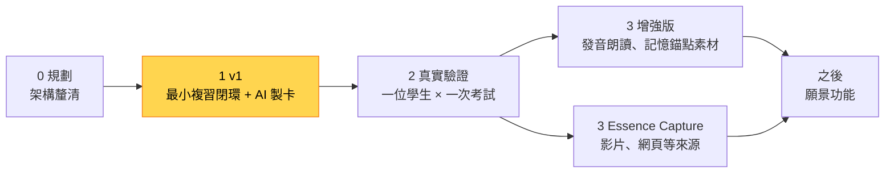

# Essence Cards｜開發現況與路線圖

更新：2026-10-23

## 現在在哪裡

| 項目 | 現況 |
|---|---|
| 階段 | **1. v1**：v1 開發前要做的事全部完成，2026-10-20 開始寫程式 |
| 產品程式碼 | 程式結構已定（[D-110](decisions.md#d-110-v1-外掛的程式結構)）；W1 骨架＋W2 卡組模組、W3 複習紀錄與 FSRS 重播（含自動檢查，[D-117](decisions.md#d-117-技術債預防機械檢查全自動ai-審查只在關鍵點)）已合併進 main（183 個測試）；下一步把 W4 今天的佇列（[任務說明](../tasks/w4.md)）交給 Codex |
| 已驗證 | Windows 與 iPhone：最小原型（2026-10-07）；複習畫面原型與實機驗證全部過門檻（2026-10-19，[D-109](decisions.md#d-109-複習畫面原型的實測結論)） |
| 下一個里程碑 | 打通「手寫卡組 → iPhone 複習 → 自評 → 排程」（W1～W6，[D-111](decisions.md#d-111-v1-的開發順序capture-延後)）；Capture 延到這之後 |

開工時只讀這一節，其他文件看任務需要再讀（[D-099](decisions.md#d-099-文件精簡)）。要找某個決定，先看[決策紀錄的索引](decisions.md#索引)；最近做完的事見[已完成](#已完成)。

### 下一次對話從這裡開始

1. **v1 第一批**（[D-111](decisions.md#d-111-v1-的開發順序capture-延後)）：W1 骨架、W2 卡組模組（[任務說明](../tasks/w1-w2.md)、[審查與修正](<../Claude Codex Discussion/2026-10-20-technical-debt-review.md>)）與 W3 複習紀錄與 FSRS 重播（[任務說明](../tasks/w3.md)，排程用 FSRS-6，[D-112](decisions.md#d-112-排程用-fsrs-6)）已合併。下一步把 W4 今天的佇列的[任務說明](../tasks/w4.md)（[D-120](decisions.md#d-120-今天的佇列的細節)）交給 Codex；W3 的 iPhone 效能（D-110 要不要加快取）在 W5 接上外掛後用 `npm run bench` 的資料量測。程式結構照 [D-110](decisions.md#d-110-v1-外掛的程式結構)；試作場已停用。之後各模組寫規格時，照 [D-115](decisions.md#d-115-回頭查要用的證據先收好) 把要多存的證據寫進出題語法，打字卡與自動朗讀照 [D-116](decisions.md#d-116-打字卡的沒印象與自動朗讀)。開始任務前，先核對 [backlog 的技術債](backlog.md#技術債)（W1～W2 審查留下的 4 件事已搬過去，[D-119](decisions.md#d-119-程式品質的-skill-整併成通用的-code-quality)）。
2. 製卡規則：學習目標的數量由內容決定（[D-101](decisions.md#d-101-學習目標的數量由內容決定)）2026-10-19 試過，沒有變瑣碎，規則不改（[試用紀錄](card-rules/trials.md)）。之後有真實的影片筆記時再試一次，順便看一般知識的數量（這次約加倍，同一份筆記 20～31 個）。下一輪試用時一併試「共同成功判準」（[backlog](backlog.md#其他待決)）。也一併看 AI 品質初篩留下的兩點：2-2 每份仍約 5 題洩漏（多是二選一與互補配對），以及把相鄰能力的一題放錯池（D-118）。
3. **AI 品質初篩** ✅ 2026-10-20 結案：兩次盲評後照兩個問題改了規則（通用 v0.13、自然 v0.5，[D-118](decisions.md#d-118-ai-品質初篩後的製卡規則修改)），T4 小規模驗證：例題的觀念都有出題、按例子拆開變少，洩漏沒變、偶爾把相鄰能力的一題放錯池（[試用紀錄](card-rules/trials.md)）。這兩點併進第 2 項的下一輪試用再看，不擋 v1。

另外的專題與研究：

- **英文製卡規則**：v0.10 依製卡流程重排並保留反例，一字多義以中文意思區分目標（[D-125](decisions.md#d-125-英文規則依製卡流程重排與一字多義的學習目標)）；發音檢查列 v2 之後（D-124）。下一步：一字多義等有多義字的真實教材時試用一次；名稱括號的程式修改寫進 W6 的任務說明（[技術債](backlog.md#技術債)）。
- **學習目標優化（Astra）**（[完整對話與整理索引](<../Claude Codex Discussion/2026-10-22-[Astra] learning-objective-optimization.md>)）：2026-10-22 依使用者要求完整收錄 13 則對話。💡 提案是以具體任務與應通過／不應通過的回答，在目標定案前檢驗判準；最後已釐清這是建立與驗收流程的改良，沒有根本改變軟體核心概念。[Claude 回應](<../Claude Codex Discussion/2026-10-22-[Astra] learning-objective-optimization.md#claude-回應2026-10-22>)：同意方向，已經是第二輪設計的 R1；逐個目標檢查可能補不到 2-1「分離屬於物理變化」這類跨知識塊的缺口。[使用者回覆](<../Claude Codex Discussion/2026-10-22-[Astra] learning-objective-optimization.md#使用者回應與-claude-的看法2026-10-22>)：結掉「跳出既有架構重想」（核心仍是 D-114）；品質看整體，不因單一張卡的失誤否定方案；重視五項做法整體；採用 R3（先畫全貌、模擬考題、再倒推目標，依理解障礙排進展），AI 可以劃定全貌的邊界，目標可變多、範圍可適度超出教材，底層不夠時可以加強第 ① 層（符合條件才補，不硬性增加）。Codex 回應六個問題後雙方一致（[結論](<../Claude Codex Discussion/2026-10-22-[Astra] learning-objective-optimization.md#結論claude-與-codex-一致2026-10-22>)）：R3 五步保留，修掉「全貌每塊都要有目標」「整合一律列其他練習」，補上回查原教材與「另立目標、同池變式或詳解」的放置分界；評分先引證據再整體判斷、不單點否決，教材外內容另外查證，價值與成本並列。已整合進第二輪設計（見下一項）。
- **學習目標架構**（[討論稿](<../Claude Codex Discussion/2026-10-21-learning-objective-architecture.md>)）：2026-10-21 使用者要求把「製卡規則的寫法」（[前一份](<../Claude Codex Discussion/2026-10-20-card-rule-writing.md>)，暫停）歸零重想，同意新方向：用真實考題當尺、先用最強的模型找天花板、比較單次與流水線（架構 → 出題 → 另一家審查），詳細規則改給審查者用。結論使用者 2026-10-21 確認（強模型用 xhigh）；單元是 2-2，保留單元 2-1、2-3，尺是第一次段考。考題已凍結、生成完成 2-1 與 2-2；第一輪只評這兩節（使用者決定，2-3 不補）。第一輪盲評完成（[評分說明](../experiments/t4/arch/評分說明.md)），2026-10-22 揭曉，報告見[討論稿〈第一輪結果〉](<../Claude Codex Discussion/2026-10-21-learning-objective-architecture.md#第一輪結果claude-報告2026-10-22>)。兩家的卡組名次不一致，所以卡組這一輪沒有贏家；兩家一致的是：缺口主要出在架構的判準太寬，S4 有核心題倒退，審查步驟幾乎沒改到架構。另外發現 2-2 的轉錄把「給學生」欄標成教師註記。Codex 已回應、Claude 已核對（第 6、8、10 題照 Codex 的解讀更正報告），雙方一致的[第二輪設計](<../Claude Codex Discussion/2026-10-21-learning-objective-architecture.md#第二輪設計claude-與-codex-一致待使用者確認>)：先修轉錄的欄位標記、校準評分，再固定 GPT-6.1 Sol xhigh 比三種提示（短規則、加判斷邊界、詳細規則），加 S1 錨點與 S0 基準，在沒用過的單元驗證；不跑 S4 與審查。使用者 2026-10-22 暫緩確認，先在 Astra 稿談完，之後整合成[第二輪設計（整合版）](<../Claude Codex Discussion/2026-10-21-learning-objective-architecture.md#第二輪設計整合版>)：R0～R3 加 S1、S0 共 6 次請求，R3 放寬範圍，開跑前先核對輸出長度。接法依 [D-126](decisions.md#d-126-訂閱優先的-ai-製卡與側欄修改) 更新為 R0～R3 先驗 G2／G3 再統一用方案額度，退回 API 就全部退回；S0 維持 API。使用者 2026-10-23 決定 S1 暫緩，整合版與驗證單元改在 Codex 那邊和使用者討論（[交接](<../Claude Codex Discussion/2026-10-21-learning-objective-architecture.md#交接給-codex和使用者討論第二輪設計與驗證單元2026-10-23>)），有結論後交 Claude 審查；接法驗證不擋 W4～W6，尚未補跑。
  - 最新：第二輪設定定案為 [D-127](decisions.md#d-127-學習目標架構第二輪sol-high第-1-章先跑-1-3)：R0～R3 用 Sol high、第 1 章先在 1-3 跑五組，R2／S0 被密度例子墊高的判讀照此，轉錄由 Codex 看原頁做。下一步：Codex 轉錄 1-3 並修 2-1、2-2 的欄位（[任務說明](../tasks/objective-architecture-r2-transcription.md)）；Claude 換格式範例、寫 R1／R3。未跑接法驗證或正式生成。
- **Claudian 評估與用訂閱製卡**：✅ 2026-10-22 使用者確認最終整合版，已結案為 [D-126](decisions.md#d-126-訂閱優先的-ai-製卡與側欄修改)。訂閱優先，API／手動備援保留；固定生成按按鈕、個別修改用筆記與側欄，證據範圍與拆分／合併的進度規則已定。G1～G4、Claude 背景接法、Claudian skill 與差異接受流程仍[待驗證](backlog.md#訂閱製卡接法驗證d-126)，在 AI 製卡模組開工時處理，不擋 W4～W6；尚未實作。使用者 2026-10-23 另要求將「透過 Claudian 跑完整學習鏈，並與固定呼叫方式比較品質」列入同節待辦，細節與時程待規劃，尚未納入第二輪。
- **AI 規劃**（[紀錄](archive/discussions/2026-10-11-ai-planning.md)），待決題目見 [backlog](backlog.md#ai-規劃2026-10-11-起的專題討論)。
- **API 挑選**（[紀錄](archive/discussions/2026-10-11-api-selection.md)）：T4 已選定轉錄用 GPT-6 Sol、製卡用 GPT-5.6 Terra（D-085）。使用者之後再測：錯題照片（照 [D-113](decisions.md#d-113-錯題整頁拍題號選填) 整頁拍，等使用者提供 2～3 張字跡潦草的真實考卷）、Mistral 的其他模型；增強版再談語音模型與模型自動更新。
- **English Kitten Academy 研究**（[報告](research/english-kitten-academy.md)、[討論稿](<../Claude Codex Discussion/2026-10-20-english-kitten-academy.md>)）：2026-10-21 結案。拼句練習、文法選擇題、造句題的可接受答案留 v2（[backlog](backlog.md#點子收集箱)）。使用者要 v1 做「片語放進句子裡打字」：答錯時的三步流程已定（[D-121](decisions.md#d-121-打字卡答錯時的三步流程)，W6 照做）；寫法、依字數畫線、好幾個正確答案用 ` | ` 分開已定（[D-122](decisions.md#d-122-片語放進句子裡打字)，英文規則 v0.8）；解析器拆開 ` | ` 寫進 W6 的任務說明（[技術債](backlog.md#技術債)）。

## 路線圖

v1 的內容已確認（[D-039](decisions.md#d-039-v1-範圍)）。💡 v1 之後的增強版與 Essence Capture，先後順序依真實驗證的結果決定。

| 階段 | 內容 | 完成條件 |
|---|---|---|
| 0 規劃 ✅ 2026-10-20 | 架構釐清七步 ✅ 2026-10-10，結果寫在 [product](product.md) 與 [architecture](architecture.md)；接著做[v1 開發前要做的事](#v1-開發前要做的事) | product.md 與 architecture.md 沒有 💬 項目；v1 範圍確定 |
| 1 v1 | [產品定義 §5](product.md#5-範圍-第-7-步)的 v1 範圍，包括 AI 製卡（[D-039](decisions.md#d-039-v1-範圍)） | 能在 iPhone 完成一次段考範圍的每日複習；附上完整的 HTML 使用說明書，並說清楚學習目標 ID 與題目指紋（[D-048](decisions.md#d-048-使用說明書)）。完工前 Claude 先問使用者：[產品路線](backlog.md#產品路線2026-10-22-使用者)（知識庫、依能力產生複習、精熟循環）要不要做進 v1 |
| 2 真實驗證 | 一位學生、一次考試 | 依[成功標準](product.md#2-成功標準-第-1-步)記錄結果，決定下一步優先順序 |
| 3 增強版 | 發音朗讀、記憶錨點的素材等；要加強什麼到時候再討論（[backlog](backlog.md#增強版待討論)） | 待定 |
| 3 Essence Capture | 另一個 repo；PDF 與圖片的轉錄已提前進 v1（D-076），這裡是影片、網頁等其他來源 | 待定 |
| 之後 | [產品定義 §5「之後」](product.md#之後方向保留暫不展開)的四組：動機與管理、應用與回饋、內容深化、生態與維運；細節見 [backlog](backlog.md) | — |

## v1 開發前要做的事

| 事項 | 內容 |
|---|---|
| 出題語法定稿 | ✅ 2026-10-16（[D-092](decisions.md#d-092-出題語法定稿正式規範)）：正式規範見[出題語法與資料格式](syntax.md)，製卡規則的輸出格式已同步；整合時補上的三個提案同一天確認 |
| 成功標準的量測方式 | ✅ 2026-10-12（[D-075](decisions.md#d-075-成功標準的量測方式)）：v1 只做積欠提醒與考前抽測，其他在第 2 階段由 AI 讀紀錄計算 |
| 複習與檢核細節 | ✅ 2026-10-13：自評段數、佇列組成、中斷與恢復等十三題都已定案（[backlog](backlog.md#複習與檢核細節v1-範圍確定後展開)） |
| 實機驗證（舊 T-008） | ✅ 2026-10-19（[試作場](../experiments/README.md) T3）：離線連續複習 15 分鐘、離線重開、恢復連線後同步都通過，三年份紀錄 iPhone 讀 0.24 秒；兩端離線改同一篇筆記會遺失一邊、裝置代碼要存本機，記入 [backlog](backlog.md#其他待決)。單一檔案救回在電腦用 Git 做，寫 v1 時處理 |
| 複習畫面樣式與入口畫面 | ✅ 2026-10-17（[試作場](../experiments/README.md) T1、T5）：複習畫面用安靜樣式、自評按鈕不顯示間隔（[D-070](decisions.md#d-070-複習畫面採用安靜樣式)）；入口一科一列（[D-095](decisions.md#d-095-入口畫面)）；顯示答案用文字按鈕、空格是底線、詳解和答案分開（[D-096](decisions.md#d-096-顯示答案與複習畫面的細節)）；目錄依學期分組、單元數字是卡片總數並用顏色表示狀態、點開有當日卡與全部卡（[D-097](decisions.md#d-097-目錄畫面)）；考試範圍只用在大考、改成考試期間（[D-098](decisions.md#d-098-考試範圍只用在大考日期改成考試期間)）。樣式稿：[入口與顯示答案](../experiments/mockups/entry-and-reveal.html)。英文自評按鈕 2026-10-17 確認（D-096）。設定頁 ✅ 2026-10-19：複習、學期、給家長三區，每日時間上限預設 30 分鐘（[D-104](decisions.md#d-104-設定頁)，依試作場 T8 的模擬），樣式照 Obsidian 內建；總覽 ✅ 2026-10-19 改成入口在電腦版、有建議時才出現的「給家長」一區（[D-103](decisions.md#d-103-總覽改成入口的給家長一區)）。「給家長」一區已補進樣式稿第 16 版；考前抽測 ✅ 2026-10-19 放在入口科目列的第一列，考前 3 天出現（[D-107](decisions.md#d-107-考前抽測放在入口科目列的第一列)）。考試範圍檔的寫法已跟著 D-098 改好（[出題語法 §4](syntax.md#4-考試範圍)） |
| 複習畫面原型 | 在[試作場](../experiments/README.md)做（T2，[D-065](decisions.md#d-065-試作場)），照 T5 選定的複習畫面（D-096）；✅ 2026-10-19 [試作外掛](../experiments/plugin/README.md)在 Windows 與 iPhone 測完：維持 React，全螢幕蓋住 Obsidian 並攔截觸控，往左滑一次一張（[D-109](decisions.md#d-109-複習畫面原型的實測結論)） |
| 開始寫程式時：建立 Capture repo | ✅ 2026-10-20 照 [D-076](decisions.md#d-076-capture-是知識入口教材轉錄成教材庫) 的補充（2026-10-14）建好骨架：[Essence-Capture](https://github.com/kuohappiness/Essence-Capture) 與本 repo 並排、AGENTS.md 指向本 repo、通用的 Claude 記憶已複製、進度只寫在本 repo。Capture 的程式延到 Cards 的複習閉環完成後（[D-111](decisions.md#d-111-v1-的開發順序capture-延後)）；Capture 完成前 AGENTS.md 要改成獨立的一份（[backlog](backlog.md#其他待決)） |
| API 模型實測 | ✅ 2026-10-14（[試作場](../experiments/README.md) T4）：轉錄用 GPT-6 Sol、製卡用 GPT-5.6 Terra（[D-085](decisions.md#d-085-首選-openai-gpt-56-terra)）。使用者之後再測：錯題照片、Mistral 的其他模型（見上面「API 挑選」） |

## 已完成

只留最近 10 條；加新的一條時，把最舊的搬到[已完成（封存）](archive/roadmap-completed.md)的最上面（[D-099](decisions.md#d-099-文件精簡)）。

| 日期 | 工作 |
|---|---|
| 2026-10-23 | 學習目標架構第二輪定案（[D-127](decisions.md#d-127-學習目標架構第二輪sol-high第-1-章先跑-1-3)）：Sol high、第 1 章先跑 1-3、密度例子的判讀、轉錄改由 Codex 做；修改 D-126 第 6 點。尚未轉錄、未跑生成 |
| 2026-10-23 | 審查第二輪的 [Codex 與使用者結論](<../Claude Codex Discussion/2026-10-21-learning-objective-architecture.md#claude-審查2026-10-23>)：核對 S0 接法、第 1 章 11 題與各提示的密度範例；更正 1-1／1-2 題數，提出 1-3 的偏差判讀與三個前置條件；待使用者確認，未寫 D-ID、未跑生成 |
| 2026-10-23 | 第二輪設計的 [Codex 與使用者結論](<../Claude Codex Discussion/2026-10-21-learning-objective-architecture.md#codex-與使用者的結論2026-10-23>)已整理：high、第 1 章與分批驗證由使用者選定，找回舊答案紀錄並釐清第 1 章仍需補標；首測 1-3 等建議待 Claude 審查，未寫 D-ID、未跑生成 |
| 2026-10-23 | 依使用者要求將「Claudian 完整學習鏈與固定呼叫的品質比較」加入 [backlog](backlog.md#訂閱製卡接法驗證d-126)；測試細節與時程待規劃，未寫 D-ID、未跑生成 |
| 2026-10-23 | 學習目標架構第二輪交接給 Codex：使用者決定 S1 暫緩，整合版與驗證單元改在 Codex 那邊討論、有結論後交 Claude 審查（[交接](<../Claude Codex Discussion/2026-10-21-learning-objective-architecture.md#交接給-codex和使用者討論第二輪設計與驗證單元2026-10-23>)）；更正「整合版已獲確認」的標示 |
| 2026-10-22 | 訂閱優先的 AI 製卡與側欄修改定案（[D-126](decisions.md#d-126-訂閱優先的-ai-製卡與側欄修改)）：保留 API／手動備援，界定生成與修改的證據、拆分／合併進度；同步第二輪接法、待驗證清單與文件，Claudian 稿結案；功能尚未實作 |
| 2026-10-22 | 補入 [Codex 對 Claude 側欄方案的回覆](<../Claude Codex Discussion/2026-10-22-claudian.md#codex-回覆側欄修改的證據與-id2026-10-22>)：同意省下專用接點與重複審核，釐清回饋證據、ID 與複習進度承接；核對 W2 現有能力，待 Claude 回應，未實作、未定案 |
| 2026-10-22 | 依使用者新方向補入 [Codex 的筆記＋側欄協作提案](<../Claude Codex Discussion/2026-10-22-claudian.md#codex-補充以筆記與側欄對話作為製卡工作區2026-10-22請-claude-回應>)：比較完整生成與修改流程、Cards 接點、AI 來源與 ID 的邊界，列四題待 Claude 回應；未實作、未定案 |
| 2026-10-22 | 英文規則 v0.10：依製卡流程重排、v0.8 反例原樣保留；一字多義以中文意思區分目標，第二個意思名稱加全形括號；變化題只用學過的文法、有時間詞也試填其他答案、錯題分開拼錯變化形與用錯時態；兩項暫緩記進 backlog（[D-125](decisions.md#d-125-英文規則依製卡流程重排與一字多義的學習目標)） |
| 2026-10-22 | 完成 [Claudian 流程簡化的 Codex 獨立方案](<../Claude Codex Discussion/2026-10-22-claudian.md#codex-的做法2026-10-22>)：由 Cards 呼叫官方 CLI 並自動接回草稿，分列日常操作與首次設定，查核能力、授權、安全及 D-115 證據；待與 Claude 封存方案盲比，未實作、未改第二輪設計 |

