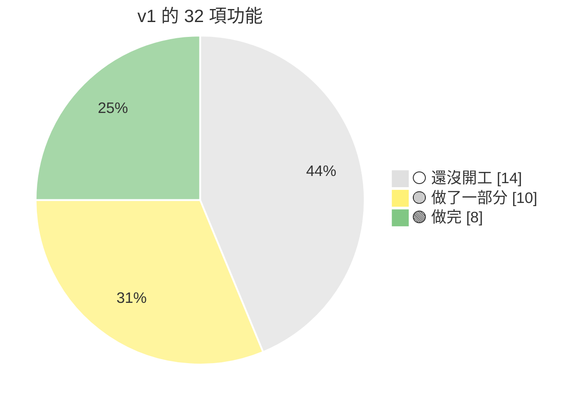
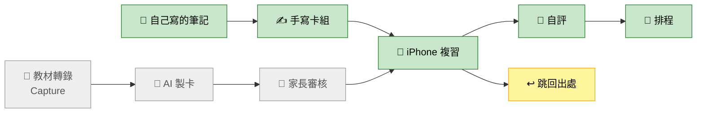
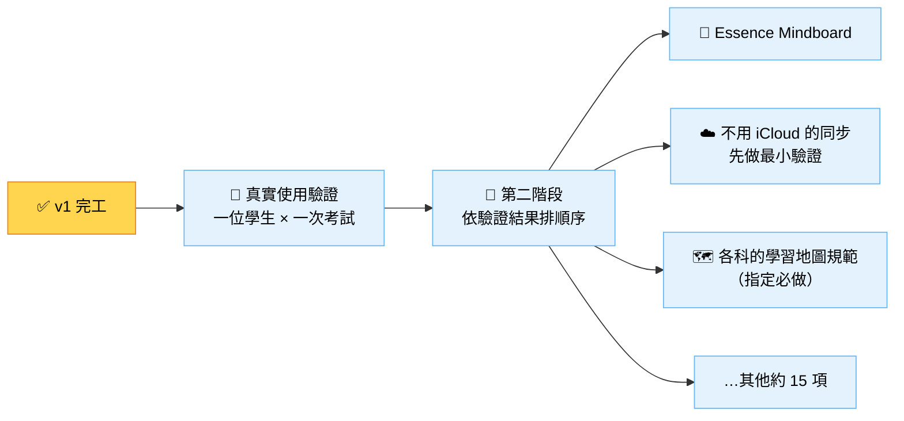

# Essence Cards｜v1 完工表（草稿）

> [!note] 草稿，還沒定案
> 2026-11-05 依 `main` 的程式與文件判斷，沒有逐項實際操作。項目照 [product.md §5 的 v1 功能表](https://github.com/kuohappiness/Essence-Cards/blob/main/docs/product.md#5-範圍-第-7-步)，共 32 項。
> 🟢 做完　🟡 做了一部分或正在做　⚪ 還沒開工

## 一眼看完

| 區塊 | 進度 | 🟢 | 🟡 | ⚪ |
|---|---|:-:|:-:|:-:|
| 📱 複習（學生每天用的） | `█████████████░░░░░░░` 64% | 6 | 6 | 2 |
| ✍️ 手寫與整理卡組 | `█████████████░░░░░░░` 63% | 2 | 1 | 1 |
| 🤖 AI 製卡 | `███░░░░░░░░░░░░░░░░░` 13% | 0 | 3 | 9 |
| 📄 教材轉錄（Essence Capture） | `░░░░░░░░░░░░░░░░░░░░` 0% | 0 | 0 | 1 |
| 📘 使用說明書 | `░░░░░░░░░░░░░░░░░░░░` 0% | 0 | 0 | 1 |
| **全部** | **`████████░░░░░░░░░░░░` 41%** | **8** | **10** | **14** |

進度用項目數算（🟢 算 1、🟡 算一半），不是工作量。還沒開工的大多是 AI 製卡和 Capture，這兩塊的工作量比複習那邊的項目大，所以照工作量算會更少。

## v1 的閉環走到哪裡

下面那條（手寫卡組 → 複習 → 排程）已經天天能用，正式版是 `0.3.0`。上面那條（教材 → AI 製卡 → 審核）還沒開工。

## 逐項

### 📱 複習（學生每天用的）

| | 功能 | 現況 |
|:-:|---|---|
| 🟢 | 今天要複習 | 入口一科一列、考試倒數 |
| 🟢 | 翻面與四級自評 | |
| 🟢 | 新卡 | |
| 🟢 | 題目池輪替 | |
| 🟢 | 排程（FSRS） | |
| 🟢 | 英文朗讀 | 上方改成喇叭圖示（D-188）等題型接點合併 |
| 🟡 | 出卡順序與濾網 | 順序做完；濾網還沒做 |
| 🟡 | 目錄與卡片管理 | 第一、二批合併；第三批（管理模式）還沒開 |
| 🟡 | 目標保持率 | 排程用了；設定頁還不能調 |
| 🟡 | 範圍與每日上限 | 考試範圍合併；小考標記可以開工；設定頁的每日上限還沒做 |
| 🟡 | 相似字比較卡 | 點選填空正在分支上實作 |
| 🟡 | 跳回出處 | 筆記可以跳；轉錄稿要等 Capture |
| ⚪ | 給家長的建議 | 入口那一區還沒做 |
| ⚪ | 考前抽測 | |

### ✍️ 手寫與整理卡組

| | 功能 | 現況 |
|:-:|---|---|
| 🟢 | 直接在 Obsidian 編輯卡組 | |
| 🟢 | 自由安排卡組位置 | |
| 🟡 | 編輯畫面標示結構 | 存檔時會提示寫錯的目標；樣式標示在第四批 |
| ⚪ | Bases 卡組清單 | |

### 🤖 AI 製卡

| | 功能 | 現況 |
|:-:|---|---|
| 🟡 | 國小社會 | 預設 v0.7，試用先停，還沒判定通過 |
| 🟡 | 國小國語 | 預設 v0.7，接著試 L8 |
| 🟡 | 不限學業的知識領域 | 規則寫好了，等 AI 製卡模組 |
| ⚪ | 訂閱接法 | 要先過 G1～G4 驗證（D-126） |
| ⚪ | 複製貼上 | |
| ⚪ | API 直連 | |
| ⚪ | AI 卡片的審核 | |
| ⚪ | AI 製卡快照 | |
| ⚪ | 筆記與側欄修改 | |
| ⚪ | 錯題補強 | |
| ⚪ | 循序漸進加深 | 主動提示的做法在等 Codex 查核 |
| ⚪ | 常錯單字補記憶錨點 | |

### 📄 教材轉錄、📘 說明書

| | 功能 | 現況 |
|:-:|---|---|
| ⚪ | 教材轉錄（Essence Capture） | repo 只有說明檔；雛形在 `experiments/t4/` |
| ⚪ | 使用說明書（HTML） | 要寫的段落已經累積在 D-048 補充 |

### 不在上表、但也是 v1 的工作

都在 [backlog 的 v1 任務](https://github.com/kuohappiness/Essence-Cards/blob/main/docs/backlog.md#v1-需要做的任務)：中文朗讀、接句卡與全詩順序卡、英文的新目標（打字與排序）、記憶錨點改圖示、系統資料夾的防呆、備份的還原畫面、下一次 iPhone 實機測試。

## v1 之後

第二階段的[清單](https://github.com/kuohappiness/Essence-Cards/blob/main/docs/backlog.md#第二階段想做的事)有 17 項，例如學習儀表板、題庫與模擬考、找錯題、FSRS 個人化、發音檢查。這些還沒排順序，等真實使用驗證的結果再排，所以現在算不出還剩多少。
